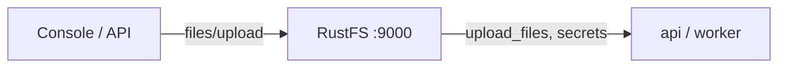
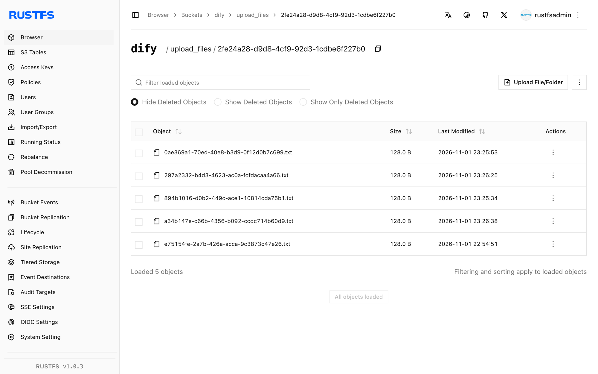

In dieser Anleitung verbinden Sie [Dify](https://github.com/langgenius/dify) — die Open-Source-Plattform für LLM-Anwendungen — über sein OpenDAL-Storage-Backend mit **RustFS**. Sie stellen die Dateispeicherung von lokalen Datenträgern auf einen RustFS-Bucket um, starten den Stack, laden ein Dokument in eine Knowledge Base hoch und bestätigen das Objekt im Bucket. Der Ablauf wurde mit Dify `1.18.0` in Docker Compose verifiziert.

Sie benötigen Docker Compose. Dieses Setup ist für lokale Integrationstests gedacht, nicht für den Produktivbetrieb.

## Architektur



Dify persistiert hochgeladene Dokumente, Knowledge-Base-Dateien und seinen Bootstrap-Secret (`.dify_secret_key`, Workspace-Schlüssel) über das konfigurierte Storage-Backend. Ist das Backend ein Bucket, liegt nichts davon auf Container-Festplatten.

## 1. Storage für RustFS konfigurieren

Schalten Sie in `docker/.env` (kopiert aus `.env.example`) OpenDAL auf das S3-Schema um:

```ini title="docker/.env"
STORAGE_TYPE=opendal
OPENDAL_SCHEME=s3
OPENDAL_S3_ENDPOINT=http://<your-rustfs-endpoint>:9000
OPENDAL_S3_BUCKET=dify
OPENDAL_S3_ACCESS_KEY_ID=<your-access-key>
OPENDAL_S3_SECRET_ACCESS_KEY=<your-secret-key>
OPENDAL_S3_REGION=us-east-1
OPENDAL_S3_ENABLE_PATH_STYLE=true
OPENDAL_S3_ROOT=/
```

Legen Sie den Bucket an, bevor Sie den Stack starten:

```bash
aws s3 mb s3://dify --endpoint-url http://<your-rustfs-endpoint>:9000
```

:::note[RustFS an das Compose-Netzwerk anbinden]

Der Compose-Stack läuft in seinem eigenen Bridge-Netzwerk, und Docker isoliert Bridges voneinander — ein Endpunkt wie `http://172.17.0.2:9000` läuft im `api`-Container in einen Timeout. Verbinden Sie den RustFS-Container mit einem Alias zum Compose-Netzwerk und verwenden Sie den Alias als Endpoint-Host:

```bash
docker network connect --alias rustfs <compose-network> <rustfs-container>
```

Erstellen Sie den Stack nach der `.env`-Änderung neu — `docker compose restart` übernimmt die alten Umgebungsvariablen.

:::

## 2. Stack starten und einrichten

```bash
cd dify/docker
docker compose up -d
```

Warten Sie auf den Health-Check des `api`-Dienstes und legen Sie das Admin-Konto im Web-UI an (`http://localhost:80`). Dify schreibt sofort seinen Bootstrap-Zustand in den Bucket:

```bash
aws s3 ls s3://dify/ --recursive \
  --endpoint-url http://<your-rustfs-endpoint>:9000
```

```text
2026-11-01 14:31:00         65 .dify_secret_key
2026-11-01 14:33:06       1674 privkeys/<tenant-id>/private.pem
```

Secret-Schlüssel und Workspace-Schlüssel liegen jetzt in RustFS — in den Containern bleibt kein relevanter Zustand.

## 3. Knowledge-Base-Dokument hochladen

Erstellen Sie eine Knowledge Base im UI und laden Sie ein Dokument hoch. Der Upload landet im Bucket unter `upload_files/<tenant-id>/`:

```bash
aws s3 ls s3://dify/upload_files/ --recursive \
  --endpoint-url http://<your-rustfs-endpoint>:9000
```

```text
2026-11-01 15:25:53        128 upload_files/<tenant-id>/0ae369a1-70ed-40e8-b3d9-0f12d0b7c699.txt
```

Das Objekt erscheint im Moment des Upload-Abschlusses — die Indizierung läuft gegen die Bucket-Kopie.



## 4. Anhalten oder Zurücksetzen

Stack abbauen und die Bucket-Objekte behalten:

```bash
docker compose down
```

Dify-Daten löschen:

```bash
aws s3 rm s3://dify --recursive \
  --endpoint-url http://<your-rustfs-endpoint>:9000
```

:::warning[Beim Zurücksetzen Bind-Mounts leeren]

Difys Compose-Datei bind-mountet Datenbank und Storage unter `docker/volumes/`. `docker compose down -v` entfernt Bind-Mounts nicht — löschen Sie `docker/volumes/` explizit, wenn Sie einen sauberen Zustand brauchen, sonst überleben das alte Admin-Konto und der Verschlüsselungszustand.

:::

## Fehlerbehebung

### Startup-Logs zeigen `tcp connect error: Connection timed out` gegen den Bucket

Der Stack erreicht die RustFS-Adresse nicht — Netzwerkisolation zwischen Docker-Bridges. Verbinden Sie RustFS wie in Schritt 1 mit einem Alias zum Compose-Netzwerk.

### Login schlägt mit `Invalid encrypted data` fehl

Das Admin-Passwortfeld wird vom Frontend Base64-kodiert; ein Klartext-Passwort über die Console-API scheitert. Nutzen Sie das Web-UI für Konto- und Passwortoperationen, oder kodieren Sie das Feld wie das Frontend.

### `Default model not found for text-embedding` beim Anlegen von Dokumenten

Der `high-quality`-Indizierungsmodus braucht einen in Dify konfigurierten Embedding-Modell-Provider. Für einen reinen Storage-Test `economy`-Indizierung verwenden oder zuerst einen Model-Provider konfigurieren.

### Uploads landen weiterhin auf lokaler Festplatte

Die Container `api` und `worker` stammen aus der Zeit vor der `.env`-Änderung. Erstellen Sie den ganzen Stack mit `docker compose up -d --force-recreate` neu, damit jeder Dienst die neue Storage-Konfiguration liest.

## Nächste Schritte

- Lesen Sie vor großen Knowledge Bases die [S3-Kompatibilitätshinweise](/administration/protocols/s3).
- Erstellen Sie dedizierte Produktionszugangsdaten mit [Zugangsdatenverwaltung](/security-compliance/iam/access-token).
- Folgen Sie der [Dify-Umgebungsvariablen-Referenz](https://docs.dify.ai/en/self-host/deploy/configuration/environments) für die separaten S3-Einstellungen des Plugin-Daemons und Multipart-Tuning auf demselben Bucket.
