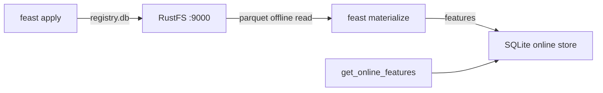
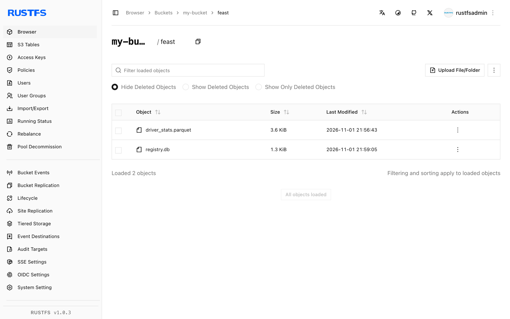

In dieser Anleitung verbinden Sie [Feast](https://github.com/feast-dev/feast) — den Open-Source-Feature-Store — mit **RustFS**, und zwar in zwei Speicherrollen zugleich: Die Feature-Registry (`registry.db`) liegt in einem Bucket, und die Offline-Feature-Quelle ist eine Parquet-Datei im selben Bucket. Sie wenden ein Feature-Repository an, materialisieren Features aus RustFS in den Online-Store und lesen sie zurück. Der Ablauf wurde mit Feast `0.67.0` verifiziert.

Sie benötigen Python 3.10+. Dieses Setup ist für lokale Integrationstests gedacht, nicht für den Produktivbetrieb.

## Architektur



Der Registry-Store liest und schreibt `registry.db` im Bucket über boto3, und der File-Offline-Store liest Parquet über s3fs — beide honorieren eigene Endpunkte, sodass die gesamte Feature-Historie im Bucket liegt, während der Online-Store lokal bleibt.

## 1. Feast mit S3-Unterstützung installieren

Das Basispaket enthält die S3-Clients nicht; installieren Sie sie explizit:

```bash
python3 -m venv .venv
./.venv/bin/pip install feast boto3 s3fs
```

Laden Sie die Offline-Feature-Daten hoch. Ersetzen Sie alle Verbindungsplatzhalter:

```bash
aws s3 cp driver_stats.parquet s3://my-bucket/feast/driver_stats.parquet \
  --endpoint-url http://<your-rustfs-endpoint>:9000
```

## 2. Das Repository konfigurieren

Erstellen Sie die Repository-Dateien. Die Registry ist eine einfache `s3://`-URI, und der Endpunkt-Override kommt aus der Umgebungsvariablen `FEAST_S3_ENDPOINT_URL`; die Datenquelle trägt ihr eigenes `s3_endpoint_override`:

```yaml title="feature_store.yaml"
project: rustfs_demo
provider: local
registry: s3://my-bucket/feast/registry.db
offline_store:
  type: file
entity_key_serialization_version: 3
```

```python title="features.py"
from datetime import timedelta
from feast import Entity, FeatureView, Field, FileSource
from feast.types import Float32, Int64

driver = Entity(name="driver", join_keys=["driver_id"])
source = FileSource(
    name="driver_stats_source",
    path="s3://my-bucket/feast/driver_stats.parquet",
    timestamp_field="event_timestamp",
    s3_endpoint_override="http://<your-rustfs-endpoint>:9000",
)
driver_stats = FeatureView(
    name="driver_stats",
    entities=[driver],
    ttl=timedelta(days=1),
    schema=[Field(name="conv_rate", dtype=Float32), Field(name="avg_daily_trips", dtype=Int64)],
    source=source,
)
```

Exportieren Sie Endpunkt und Zugangsdaten für den Registry-Client:

```bash
export FEAST_S3_ENDPOINT_URL=http://<your-rustfs-endpoint>:9000
export AWS_ACCESS_KEY_ID=<your-access-key>
export AWS_SECRET_ACCESS_KEY=<your-secret-key>
export AWS_DEFAULT_REGION=us-east-1
```

## 3. Repository anwenden und materialisieren

`feast apply` schreibt `registry.db` in den Bucket; `materialize-incremental` liest die Parquet-Features aus RustFS in den lokalen Online-Store:

```bash
./.venv/bin/feast apply
./.venv/bin/feast materialize-incremental 2026-11-02T00:00:00Z
```

```text
Created entity driver
Created feature view driver_stats
...
driver_stats from 2026-10-31 ... to 2026-11-02 00:00:00+00:00:
```

Bestätigen Sie das Registry-Objekt in RustFS:

```bash
aws s3 ls s3://my-bucket/feast/ \
  --endpoint-url http://<your-rustfs-endpoint>:9000
```

```text
2026-11-01 13:57:58       1322 registry.db
2026-11-01 13:56:43       3680 driver_stats.parquet
```



## 4. Features zurücklesen

```bash
./.venv/bin/python - <<'PY'
from feast import FeatureStore
store = FeatureStore(repo_path=".")
res = store.get_online_features(
    features=["driver_stats:conv_rate", "driver_stats:avg_daily_trips"],
    entity_rows=[{"driver_id": 101}],
).to_dict()
print("conv_rate:", res["conv_rate"][0])
print("avg_daily_trips:", res["avg_daily_trips"][0])
PY
```

```text
conv_rate: 0.699999988079071
avg_daily_trips: 130
```

Die bereitgestellten Features wurden aus der Parquet-Datei materialisiert, die RustFS speichert.

## 5. Anhalten oder Zurücksetzen

Die Repository-Objekte löschen:

```bash
aws s3 rm s3://my-bucket/feast --recursive \
  --endpoint-url http://<your-rustfs-endpoint>:9000
```

## Fehlerbehebung

### `Could not import module 'feast.infra.registry.s3'`

Der S3-Registry-Store benötigt `boto3`, das das Basispaket von Feast nicht installiert. `pip install boto3` (und `s3fs` für den Offline-Store) löst das.

### `Install s3fs to access S3` bei der Materialisierung

Der File-Offline-Store liest Parquet über `s3fs`. Installieren Sie es zusammen mit `boto3` wie in Schritt 1.

### Der Registry-S3-Store ignoriert den Endpunkt

Die Registry liest ihren Endpunkt nur aus der Umgebungsvariablen `FEAST_S3_ENDPOINT_URL` — ein einfaches `AWS_ENDPOINT_URL` wird dort nicht honoriert. Die `FileSource` trägt stattdessen ihr eigenes `s3_endpoint_override`; beides ist erforderlich.

### Eine Deprecation-Warnung zur Entity-Key-Serialisierung

Setzen Sie `entity_key_serialization_version: 3` in `feature_store.yaml` — Versionen unter 3 werden für neue Online-Stores nicht mehr akzeptiert.

## Nächste Schritte

- Lesen Sie, bevor Sie Produktions-Registries auf den Bucket zeigen lassen, die [S3-Kompatibilitätshinweise](/administration/protocols/s3).
- Erstellen Sie dedizierte Produktionszugangsdaten mit [Zugangsdatenverwaltung](/security-compliance/iam/access-token).
- Folgen Sie der [Feast-Dokumentation](https://docs.feast.dev/) für Streaming-Quellen, Feature-Serving und Registry-Alternativen auf demselben Bucket.
