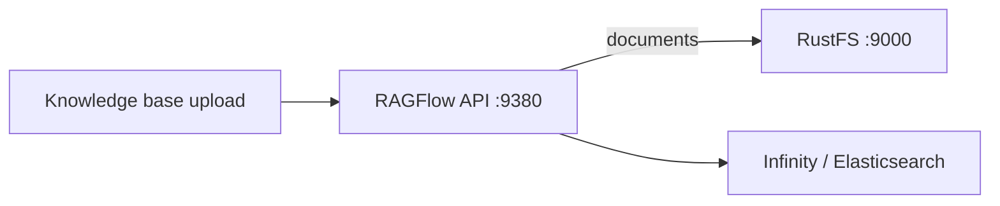

In dieser Anleitung verbinden Sie [RAGFlow](https://github.com/infiniflow/ragflow) — die Open-Source-RAG-Engine — mit **RustFS** als Objektspeicher. RAGFlow legt jedes hochgeladene Dokument und Parsing-Artefakt über seine MinIO-kompatible Client-Konfiguration in S3-kompatiblem Storage ab. Sie richten diese Konfiguration auf RustFS, starten den Stack, laden ein Dokument in eine Knowledge Base hoch und bestätigen das Objekt im Bucket. Der Ablauf wurde mit `infiniflow/ragflow:v1.0.0-rc3` und der Infinity-Document-Engine verifiziert.

Sie benötigen Docker Compose. Dieses Setup ist für lokale Integrationstests gedacht, nicht für den Produktivbetrieb.

## Architektur



Jeder Tenant erhält einen Bucket mit seiner Tenant-ID als Namen, und jede hochgeladene Datei wird zu einem Objekt in diesem Bucket. Das Parsing schreibt weitere Artefakte neben das Quelldokument.

## 1. Den Stack auf RustFS konfigurieren

Klonen Sie RAGFlow und bearbeiten Sie `docker/.env`. Wählen Sie die Infinity-Document-Engine und richten Sie den Storage-Client auf RustFS:

```ini title="docker/.env"
DOC_ENGINE=infinity
MINIO_HOST=<your-rustfs-endpoint>
MINIO_USER=<your-access-key>
MINIO_PASSWORD=<your-secret-key>
```

Der Abschnitt `minio:` in `docker/service_conf.yaml.template` wird aus diesen Variablen gerendert — dieselben Felder steuern jeden S3-kompatiblen Endpunkt. RAGFlow erzeugt automatisch einen Bucket pro Tenant; ein Voraussetzen ist nicht nötig.

:::note[RustFS-Container mit Netzwerkalias versehen]

Der Compose-Stack läuft in seinem eigenen Bridge-Netzwerk, und Docker isoliert Bridges voneinander — die Adresse `172.17.0.x` des RustFS-Containers ist aus dem Stack nicht erreichbar. Verbinden Sie RustFS mit einem Alias zum Compose-Netzwerk und verwenden Sie den Alias als `MINIO_HOST`:

```bash
docker network connect --alias rustfs ragflow_ragflow <rustfs-container>
```

Ersetzen Sie bei Bedarf auch das mitgelieferte MinIO-Image (von quay.io), falls Ihre Registry es blockiert — der Stack spricht es nicht an, wenn `MINIO_HOST` woandershin zeigt.

:::

## 2. Den Stack starten

```bash
cd ragflow/docker
docker compose -p ragflow up -d
```

Warten Sie auf die API und prüfen Sie die vom Server geladene Storage-Konfiguration:

```bash
docker logs ragflow-cpu 2>&1 | grep "minio:"
```

```text
minio: {'user': '...', 'password': '...', 'host': 'rustfs:9000', 'bucket': '', 'prefix_path': ''}
```

Ein leerer `bucket` ist erwartet: RAGFlow legt beim ersten Upload automatisch einen Bucket pro Tenant an.

## 3. Ein Dokument in eine Knowledge Base hochladen

Erstellen Sie Benutzer und API-Key (im Web-UI unter `https://localhost:443` oder über die User-API) und nutzen Sie die HTTP-API:

```bash
curl -s -X POST http://localhost:9380/api/v1/datasets \
  -H "Authorization: Bearer <your-api-key>" -H "Content-Type: application/json" \
  -d '{"name":"rustfs-kb"}'

curl -s -X POST "http://localhost:9380/api/v1/datasets/<dataset-id>/documents" \
  -H "Authorization: Bearer <your-api-key>" \
  -F "file=@rustfs-overview.txt"
```

```json
{"code":0,"data":[{"chunk_method":"naive","location":"rustfs-overview.txt","name":"rustfs-overview.txt","run":"UNSTART"}]}
```

Bestätigen Sie, dass das Objekt in RustFS gelandet ist — der Tenant-Bucket trägt die Tenant-ID:

```bash
aws s3 ls s3://<tenant-id>/ --recursive \
  --endpoint-url http://<your-rustfs-endpoint>:9000
```

```text
2026-11-01 16:02:41        204 rg-doc.txt
```

Lesen Sie das Objekt zurück und vergleichen Sie es mit der hochgeladenen Datei:

```bash
aws s3 cp s3://<tenant-id>/rg-doc.txt - \
  --endpoint-url http://<your-rustfs-endpoint>:9000
```


## 4. Parsen und abrufen

Das Dokument-Parsing (`PUT /api/v1/datasets/{id}/documents/{doc_id}` mit `{"run":"parse"}`) konsumiert das gespeicherte Objekt aus RustFS und schreibt Chunk-Artefakte daneben. Das Parsing benötigt zusätzlich ein in RAGFlow konfiguriertes Embedding-Modell — dieser Schritt hängt von Ihrem Modell-Setup ab, nicht vom Storage.

## 5. Anhalten oder Zurücksetzen

Stack anhalten und die Bucket-Objekte behalten:

```bash
docker compose -p ragflow stop
```

Tenant-Daten löschen:

```bash
aws s3 rm s3://<tenant-id> --recursive \
  --endpoint-url http://<your-rustfs-endpoint>:9000
```

## Fehlerbehebung

### Upload erfolgreich, aber nichts in RustFS

Der Server spricht noch das mitgelieferte MinIO an. Prüfen Sie die `minio:`-Zeile im Startlog — zeigt der Host nicht auf Ihren RustFS-Alias, hat die `.env`-Änderung den Container nicht erreicht; erstellen Sie ihn neu mit `docker compose -p ragflow up -d --force-recreate ragflow-cpu`.

### `tcp connect error: Connection timed out` beim Start

Die RustFS-Containeradresse ist aus dem Compose-Netzwerk nicht routbar. Verbinden Sie RustFS wie in Schritt 1 mit einem Alias zum Compose-Netzwerk und verwenden Sie den Alias in `MINIO_HOST`.

### `Authentication error: API key is invalid!` auf `/api/v1`

Die `/api/v1`-SDK-Routen erwarten einen RAGFlow-API-Key (im Web-UI erstellt), nicht den Login-Access-Token. `/v1/*`-Routen nutzen die Login-Session.

### Passwortfehler bei Registrierung oder Login

RAGFlow erwartet das Passwort vor dem API-Aufruf mit seinem mitgelieferten RSA-Public-Key verschlüsselt — das Web-UI erledigt das. Nutzen Sie das UI zur Kontoerstellung, sofern Sie die clientseitige Verschlüsselung nicht nachbauen.

## Nächste Schritte

- Lesen Sie vor umfangreicher Ingestion die [S3-Kompatibilitätshinweise](/administration/protocols/s3).
- Erstellen Sie dedizierte Produktionszugangsdaten mit [Zugangsdatenverwaltung](/security-compliance/iam/access-token).
- Folgen Sie der [RAGFlow-Dokumentation](https://ragflow.io/docs/dev/) für Chunk-Templates, Embedding-Modelle und Agent-Workflows auf demselben Bucket.
