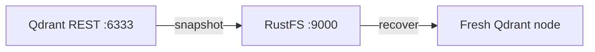

In dieser Anleitung verbinden Sie [Qdrant](https://github.com/qdrant/qdrant) — die Open-Source-Vektordatenbank für KI-Suche und RAG — mit **RustFS** als Snapshot-Speicher. Sie aktivieren S3-gestützte Snapshots, erstellen eine Collection mit Vektoren, laden einen Snapshot in den Bucket hoch und stellen ihn auf einem frischen Knoten wieder her. Der Ablauf wurde mit `qdrant/qdrant:v1.20.0` verifiziert, das Snapshots über Path-Style-Adressierung in einem RustFS-Bucket ablegt.

Sie benötigen Docker. Dieses Setup ist für lokale Integrationstests gedacht, nicht für den Produktivbetrieb.

## Architektur



Mit `snapshots_storage: s3` wird jeder Collection-Snapshot unter `<prefix>/snapshots/<collection>/` in den Bucket hochgeladen. Ein neuer Knoten, der auf denselben Bucket zeigt, kann jede Collection ohne lokale Dateien wiederaufbauen.

## 1. Qdrant auf RustFS richten

Konfigurieren Sie den Snapshot-Speicher über Umgebungsvariablen — das Präfix `QDRANT__` bildet den Konfigurationsbaum ab, und `S3_CONFIG__ENDPOINT_URL` ist das Feld für eigene Endpunkte von MinIO-Klasse-Speichern. Der Bucket muss vorab existieren; das Präfix darf leer sein.

```bash
docker run -d --name qdrant -p 6333:6333 \
  -e QDRANT__STORAGE__SNAPSHOTS_CONFIG__SNAPSHOTS_STORAGE=s3 \
  -e QDRANT__STORAGE__SNAPSHOTS_CONFIG__S3_CONFIG__BUCKET=my-bucket \
  -e QDRANT__STORAGE__SNAPSHOTS_CONFIG__S3_CONFIG__PREFIX=qdrant \
  -e QDRANT__STORAGE__SNAPSHOTS_CONFIG__S3_CONFIG__REGION=us-east-1 \
  -e QDRANT__STORAGE__SNAPSHOTS_CONFIG__S3_CONFIG__ACCESS_KEY=<your-access-key> \
  -e QDRANT__STORAGE__SNAPSHOTS_CONFIG__S3_CONFIG__SECRET_KEY=<your-secret-key> \
  -e QDRANT__STORAGE__SNAPSHOTS_CONFIG__S3_CONFIG__ENDPOINT_URL=http://<your-rustfs-endpoint>:9000 \
  qdrant/qdrant:v1.20.0
```

:::note[Pfad QDRANT__STORAGE__SNAPSHOTS_CONFIG verwenden]

In veröffentlichten Qdrant-Versionen liegen die Einstellungen unter `storage.snapshots_config` (nicht `storage.snapshots`), und der S3-Schlüssel für den Endpunkt heißt `endpoint_url`. Eine eingebundene `custom_config.yaml` mit älteren Schlüsselnamen wird stillschweigend ignoriert — Snapshots landen weiter im lokalen `./snapshots`-Verzeichnis. Prüfen Sie den Wechsel daran, dass das lokale Verzeichnis nach einem Snapshot leer bleibt.

:::

## 2. Collection anlegen und Snapshot erzeugen

Collection erstellen, Punkte einfügen, Snapshot anfordern:

```bash
curl -s -X PUT http://localhost:6333/collections/demo \
  -H "Content-Type: application/json" \
  -d '{"vectors":{"size":4,"distance":"Dot"}}'

curl -s -X PUT "http://localhost:6333/collections/demo/points?wait=true" \
  -H "Content-Type: application/json" \
  -d '{"points":[{"id":1,"vector":[0.1,0.2,0.3,0.4],"payload":{"city":"Berlin"}},{"id":2,"vector":[0.9,0.8,0.7,0.6],"payload":{"city":"Tokyo"}}]}'

curl -s -X POST http://localhost:6333/collections/demo/snapshots
```

```json
{"result":{"name":"demo-8437507706552082-2026-11-01-13-31-15-0.snapshot","size":64512},"status":"ok"}
```

Bestätigen Sie, dass das Snapshot-Objekt in RustFS gelandet ist. Ersetzen Sie alle Verbindungsplatzhalter:

```bash
aws s3 ls s3://my-bucket/qdrant/ --recursive \
  --endpoint-url http://<your-rustfs-endpoint>:9000
```

```text
2026-11-01 13:31:15  64512 qdrant/snapshots/demo/demo-8437507706552082-2026-11-01-13-31-15-0.snapshot
```


## 3. Auf einem frischen Knoten wiederherstellen

Ein Snapshot wird in eine Collection mit demselben Namen wiederhergestellt. Setzen Sie den lokalen Knoten zurück (oder starten Sie einen zweiten), der auf denselben Bucket zeigt, laden Sie den Snapshot aus RustFS herunter und übergeben Sie ihn an die Recovery-API:

```bash
aws s3 cp "s3://my-bucket/qdrant/snapshots/demo/demo-8437507706552082-2026-11-01-13-31-15-0.snapshot" . \
  --endpoint-url http://<your-rustfs-endpoint>:9000

curl -s -X POST "http://localhost:6333/collections/demo/snapshots/upload?priority=snapshot" \
  -F "snapshot=@demo-8437507706552082-2026-11-01-13-31-15-0.snapshot"
```

Stellen Sie die wiederhergestellten Daten fest:

```bash
curl -s -X POST http://localhost:6333/collections/demo/points/scroll \
  -H "Content-Type: application/json" -d '{"limit":2,"with_payload":true}'
```

```json
{"result":{"points":[{"id":1,"payload":{"city":"Berlin"}},{"id":2,"payload":{"city":"Tokyo"}}]},"status":"ok"}
```

Vektoren und Payloads kommen vollständig aus dem Snapshot, den RustFS gespeichert hat.

## 4. Anhalten oder Zurücksetzen

Demo abreißen und die Bucket-Objekte behalten:

```bash
docker rm -f qdrant
```

Gespeicherte Snapshots löschen:

```bash
aws s3 rm s3://my-bucket/qdrant --recursive \
  --endpoint-url http://<your-rustfs-endpoint>:9000
```

## Fehlerbehebung

### Snapshots erscheinen weiterhin unter `/qdrant/snapshots` im Container

Der Speicherwechsel wurde nicht übernommen — falscher Env-Pfad oder eine alte Konfigurationsdatei überschreibt ihn. Verwenden Sie exakt die Variablen `QDRANT__STORAGE__SNAPSHOTS_CONFIG__*` aus Schritt 1 und starten Sie den Container neu; prüfen Sie danach, dass das lokale Snapshot-Verzeichnis leer bleibt.

### `Wrong input: Snapshot is not compatible with existing collection`

Die Ziel-Collection existiert bereits mit anderem Schema. Löschen Sie die leere oder veraltete Collection vor der Wiederherstellung — die Upload-API erzeugt die Collection aus dem Snapshot.

### Nach einem Snapshot ist der Bucket leer

Bucket-Name oder Endpunkt ist falsch. Der Endpunkt muss das Schema enthalten, und der Bucket muss existieren; der Objektschlüssel lautet `<prefix>/snapshots/<collection>/<name>.snapshot` — listen Sie rekursiv auf.

## Nächste Schritte

- Lesen Sie vor geplanten Snapshot-Backups die [S3-Kompatibilitätshinweise](/administration/protocols/s3).
- Erstellen Sie dedizierte Produktionszugangsdaten mit [Zugangsdatenverwaltung](/security-compliance/iam/access-token).
- Folgen Sie der [Qdrant-Snapshot-Dokumentation](https://qdrant.tech/documentation/snapshots/) für Full-Storage-Snapshots, Shard-Snapshots und Versionskompatibilität auf demselben Bucket.
