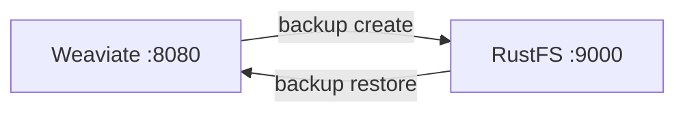
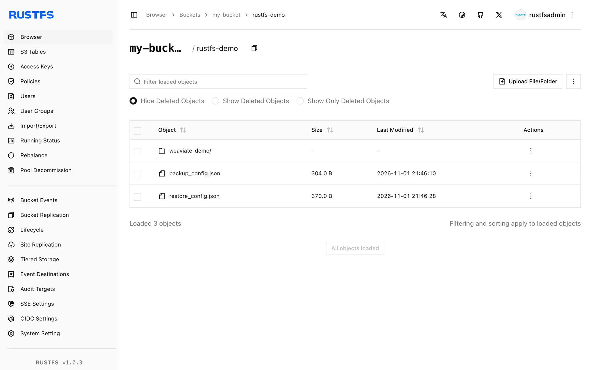

In dieser Anleitung verbinden Sie [Weaviate](https://github.com/weaviate/weaviate) — die Open-Source-Vektordatenbank für KI-Suche und RAG — über sein `backup-s3`-Modul mit **RustFS**. Sie aktivieren das Modul, erstellen eine Collection mit Vektoren, erzeugen ein Backup im Bucket und stellen es wieder her. Der Ablauf wurde mit `semitechnologies/weaviate:1.31.0` gegen einen RustFS-Bucket verifiziert.

Sie benötigen Docker. Dieses Setup ist für lokale Integrationstests gedacht, nicht für den Produktivbetrieb.

## Architektur



Ein Backup schreibt `backup_config.json`, je Klasse eine `backup.json` und Daten-Chunks in das Bucket-Präfix `<backup-id>/`. Die Wiederherstellung liest sie unter denselben Collection-Namen zurück.

## 1. Das backup-s3-Modul aktivieren

Starten Sie Weaviate mit dem Modul und seinen S3-Einstellungen. Die Zugangsdaten laufen über die Standard-AWS-Variablen — in Weaviate 1.31 liest das Modul `AWS_ACCESS_KEY_ID` und `AWS_SECRET_ACCESS_KEY`, nicht `BACKUP_S3_ACCESS_KEY_ID`:

```bash
docker run -d --name weaviate -p 8080:8080 \
  -e QUERY_DEFAULTS_LIMIT=20 \
  -e AUTHENTICATION_ANONYMOUS_ACCESS_ENABLED=true \
  -e PERSISTENCE_DATA_PATH=/var/lib/weaviate \
  -e ENABLE_MODULES=backup-s3 \
  -e BACKUP_S3_BUCKET=my-bucket \
  -e AWS_REGION=us-east-1 \
  -e AWS_ACCESS_KEY_ID=<your-access-key> \
  -e AWS_SECRET_ACCESS_KEY=<your-secret-key> \
  -e BACKUP_S3_ENDPOINT=<your-rustfs-endpoint>:9000 \
  -e BACKUP_S3_USE_SSL=false \
  -e CLUSTER_HOSTNAME=weaviate-demo \
  semitechnologies/weaviate:1.31.0
```

:::note[Endpunktformat und Zugangsdaten]

`BACKUP_S3_ENDPOINT` erwartet Host und Port ohne Schema — der AWS SDK Go v1-Client hinter dem Modul weist `http://...` mit `Endpoint url cannot have fully qualified paths` zurück. TLS steuert `BACKUP_S3_USE_SSL=false`, die Anfragen erfolgen im Path-Style. Setzen Sie nur `BACKUP_S3_ACCESS_KEY_ID` statt `AWS_ACCESS_KEY_ID`, bleibt der Client anonym, und jeder Backup-Aufruf schlägt mit `Access Denied` fehl.

:::

Prüfen Sie, dass das Modul aktiv ist:

```bash
curl -s http://localhost:8080/v1/meta | grep -o "backup-s3"
```

## 2. Collection anlegen und sichern

In Weaviate 1.31 wird das Schema per `POST /v1/schema` erzeugt. Zwei Objekte einfügen, dann das Backup starten:

```bash
curl -s -X POST http://localhost:8080/v1/schema \
  -H "Content-Type: application/json" \
  -d '{"class":"Doc","vectorizer":"none","properties":[{"name":"title","dataType":["text"]}]}'

curl -s -X POST http://localhost:8080/v1/objects -H "Content-Type: application/json" \
  -d '{"class":"Doc","properties":{"title":"RustFS vector backup"},"vector":[0.11,0.22,0.33,0.44]}'

curl -s -X POST http://localhost:8080/v1/backups/s3 -H "Content-Type: application/json" \
  -d '{"id":"rustfs-demo"}'
```

```json
{"backend":"s3","classes":["Doc"],"id":"rustfs-demo","path":"s3://my-bucket/rustfs-demo","status":"STARTED"}
```

Warten Sie auf `SUCCESS` und bestätigen Sie die Objekte in RustFS. Ersetzen Sie alle Verbindungsplatzhalter:

```bash
curl -s http://localhost:8080/v1/backups/s3/rustfs-demo
aws s3 ls s3://my-bucket/rustfs-demo/ --recursive \
  --endpoint-url http://<your-rustfs-endpoint>:9000
```

```text
2026-11-01 13:46:10        304 rustfs-demo/backup_config.json
2026-11-01 13:46:08       1406 rustfs-demo/weaviate-demo/Doc/chunk-1
2026-11-01 13:46:08      27666 rustfs-demo/weaviate-demo/backup.json
```



## 3. Wiederherstellen

Das Backup in Weaviate zurückspielen (für eine saubere Wiederherstellung vorher die Live-Collection löschen):

```bash
curl -s -X POST http://localhost:8080/v1/backups/s3/rustfs-demo/restore \
  -H "Content-Type: application/json" -d '{}'
```

Abfrage der wiederhergestellten Daten:

```bash
curl -s -X POST http://localhost:8080/v1/graphql -H "Content-Type: application/json" \
  -d '{"query":"{Get{Doc(limit:2){title}}}"}'
```

```json
{"data":{"Get":{"Doc":[{"title":"RustFS vector backup"},{"title":"Weaviate on object storage"}]}}}
```

## 4. Anhalten oder Zurücksetzen

Demo abreißen und die Bucket-Objekte behalten:

```bash
docker rm -f weaviate
```

Gespeichertes Backup löschen:

```bash
aws s3 rm s3://my-bucket/rustfs-demo --recursive \
  --endpoint-url http://<your-rustfs-endpoint>:9000
```

## Fehlerbehebung

### `Endpoint url cannot have fully qualified paths` beim Start

`BACKUP_S3_ENDPOINT` enthält ein Schema. Verwenden Sie die nackte `host:port`-Form und setzen Sie `BACKUP_S3_USE_SSL=false`.

### `Access Denied` beim Erzeugen eines Backups

Das Modul hat keine Zugangsdaten gefunden. In Weaviate 1.31 liest der S3-Client `AWS_ACCESS_KEY_ID` und `AWS_SECRET_ACCESS_KEY` (oder `AWS_ACCESS_KEY`/`AWS_SECRET_KEY`) aus der Umgebung — die Variable `BACKUP_S3_ACCESS_KEY_ID` allein genügt nicht.

### In der Fehlermeldung erscheint `s3://my-bucket/s3Path/...`

`BACKUP_S3_PATH` ist in dieser Version ein Bucket-Unterpräfix, kein Path-Style-Schalter — setzen Sie es nicht auf `s3Path`. Der Weaviate-S3-Client verwendet für eigene Endpunkte automatisch Path-Style.

### `check if backup ... exists` schlägt mit unerwartetem Fehler fehl

Der Container erreicht RustFS nicht. Prüfen Sie, ob der Endpunkt-Host auflöst und der Bucket existiert.

## Nächste Schritte

- Lesen Sie vor automatisierten Backup-Zeitplänen die [S3-Kompatibilitätshinweise](/administration/protocols/s3).
- Erstellen Sie dedizierte Produktionszugangsdaten mit [Zugangsdatenverwaltung](/security-compliance/iam/access-token).
- Folgen Sie der [Weaviate-Backup-Dokumentation](https://docs.weaviate.io/deploy/configuration/backups) für Restore-Filter, rollenbasierte Backups und Dateisystem-Alternativen auf demselben Bucket.
