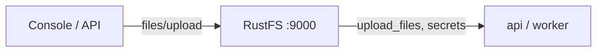

This guide connects [Dify](https://github.com/langgenius/dify) — the open-source LLM application platform — to **RustFS** through its OpenDAL storage backend. You will switch the file storage from local disk to a RustFS bucket, start the stack, upload a document into a knowledge base, and confirm the object in the bucket. The workflow was verified with Dify `1.18.0` in Docker Compose.

You need Docker Compose. This deployment is intended for local integration testing, not production.

## Architecture



Dify persists uploaded documents, knowledge-base files, and its bootstrap secret (`​.dify_secret_key`, workspace keys) through the configured storage backend. When the backend is a bucket, none of these live on container disks.

## 1. Configure storage for RustFS

In `docker/.env` (copied from `.env.example`), switch OpenDAL to the S3 scheme:

```ini title="docker/.env"
STORAGE_TYPE=opendal
OPENDAL_SCHEME=s3
OPENDAL_S3_ENDPOINT=http://<your-rustfs-endpoint>:9000
OPENDAL_S3_BUCKET=dify
OPENDAL_S3_ACCESS_KEY_ID=<your-access-key>
OPENDAL_S3_SECRET_ACCESS_KEY=<your-secret-key>
OPENDAL_S3_REGION=us-east-1
OPENDAL_S3_ENABLE_PATH_STYLE=true
OPENDAL_S3_ROOT=/
```

Create the bucket before starting the stack:

```bash
aws s3 mb s3://dify --endpoint-url http://<your-rustfs-endpoint>:9000
```

:::note[Attach RustFS to the Compose network]

The Compose stack lives in its own bridge network, and Docker isolates bridges from each other — an endpoint like `http://172.17.0.2:9000` times out from the `api` container. Attach the RustFS container to the Compose network with an alias and use the alias as the endpoint host:

```bash
docker network connect --alias rustfs <compose-network> <rustfs-container>
```

Recreate the stack after changing `.env` — `docker compose restart` keeps the old environment variables.

:::

## 2. Start the stack and set up

```bash
cd dify/docker
docker compose up -d
```

Wait for the `api` health check to pass, then create the admin account in the web UI (`http://localhost:80`). Dify immediately writes its bootstrap state into the bucket:

```bash
aws s3 ls s3://dify/ --recursive \
  --endpoint-url http://<your-rustfs-endpoint>:9000
```

```text
2026-11-01 14:31:00         65 .dify_secret_key
2026-11-01 14:33:06       1674 privkeys/<tenant-id>/private.pem
```

The secret key and workspace keys now live in RustFS — the containers hold no state that matters.

## 3. Upload a knowledge-base document

Create a knowledge base in the UI, then upload a document. The upload lands in the bucket under `upload_files/<tenant-id>/`:

```bash
aws s3 ls s3://dify/upload_files/ --recursive \
  --endpoint-url http://<your-rustfs-endpoint>:9000
```

```text
2026-11-01 15:25:53        128 upload_files/<tenant-id>/0ae369a1-70ed-40e8-b3d9-0f12d0b7c699.txt
```

The object appears the moment the upload finishes — indexing runs against the bucket copy.


## 4. Stop or reset

To tear down the stack while keeping the bucket objects:

```bash
docker compose down
```

To delete the Dify data:

```bash
aws s3 rm s3://dify --recursive \
  --endpoint-url http://<your-rustfs-endpoint>:9000
```

:::warning[Wipe bind mounts when resetting]

Dify's Compose file bind-mounts its database and storage under `docker/volumes/`. `docker compose down -v` does not remove bind mounts — delete `docker/volumes/` explicitly when you need a clean slate, or the old admin account and encryption state survive.

:::

## Troubleshooting

### Startup logs show `tcp connect error: Connection timed out` against the bucket

The stack cannot reach the RustFS address — network isolation between Docker bridges. Attach RustFS to the Compose network with an alias as shown in step 1.

### Login fails with `Invalid encrypted data`

The admin password field is Base64-encoded by the frontend; a raw password over the console API fails. Use the web UI for account and password operations, or encode the field the way the frontend does.

### `Default model not found for text-embedding` when creating documents

The `high-quality` indexing mode needs an embedding model provider configured in Dify. Use `economy` indexing for a storage-only test, or configure a model provider first.

### Uploads still land on local disk

The `api` and `worker` containers predate the `.env` change. Recreate the whole stack with `docker compose up -d --force-recreate` so every service reads the new storage configuration.

## Next steps

- Review [S3 compatibility notes](/administration/protocols/s3) before enabling large knowledge bases.
- Create dedicated production credentials with [Access Key Management](/security-compliance/iam/access-token).
- Follow the [Dify environment variables reference](https://docs.dify.ai/en/self-host/deploy/configuration/environments) for the plugin daemon's separate S3 settings and multipart tuning on the same bucket.
