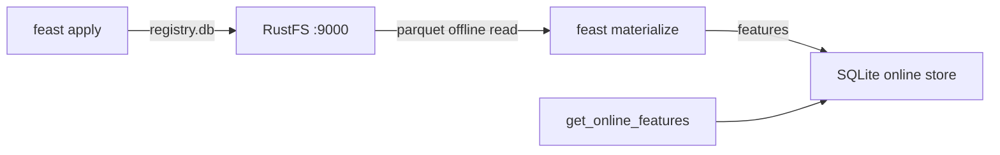

This guide connects [Feast](https://github.com/feast-dev/feast) — the open-source feature store — to **RustFS** for two storage roles at once: the feature registry (`registry.db`) lives in a bucket, and the offline feature source is a Parquet file in the same bucket. You will apply a feature repository, materialize features from RustFS into the online store, and read them back. The workflow was verified with Feast `0.67.0`.

You need Python 3.10+. This deployment is intended for local integration testing, not production.

## Architecture



The registry store reads and writes `registry.db` in the bucket over boto3, and the file offline store reads Parquet over s3fs — both honor custom endpoints, so the whole feature-history layer is bucket-backed while the online store stays local.

## 1. Install Feast with S3 support

The base package omits the S3 clients; install them explicitly:

```bash
python3 -m venv .venv
./.venv/bin/pip install feast boto3 s3fs
```

Upload the offline feature data, replacing all connection placeholders:

```bash
aws s3 cp driver_stats.parquet s3://my-bucket/feast/driver_stats.parquet \
  --endpoint-url http://<your-rustfs-endpoint>:9000
```

## 2. Configure the repository

Create the repository files. The registry is a plain `s3://` URI and the endpoint override comes from the `FEAST_S3_ENDPOINT_URL` environment variable; the data source carries its own `s3_endpoint_override`:

```yaml title="feature_store.yaml"
project: rustfs_demo
provider: local
registry: s3://my-bucket/feast/registry.db
offline_store:
  type: file
entity_key_serialization_version: 3
```

```python title="features.py"
from datetime import timedelta
from feast import Entity, FeatureView, Field, FileSource
from feast.types import Float32, Int64

driver = Entity(name="driver", join_keys=["driver_id"])
source = FileSource(
    name="driver_stats_source",
    path="s3://my-bucket/feast/driver_stats.parquet",
    timestamp_field="event_timestamp",
    s3_endpoint_override="http://<your-rustfs-endpoint>:9000",
)
driver_stats = FeatureView(
    name="driver_stats",
    entities=[driver],
    ttl=timedelta(days=1),
    schema=[Field(name="conv_rate", dtype=Float32), Field(name="avg_daily_trips", dtype=Int64)],
    source=source,
)
```

Export the endpoint and credentials for the registry client:

```bash
export FEAST_S3_ENDPOINT_URL=http://<your-rustfs-endpoint>:9000
export AWS_ACCESS_KEY_ID=<your-access-key>
export AWS_SECRET_ACCESS_KEY=<your-secret-key>
export AWS_DEFAULT_REGION=us-east-1
```

## 3. Apply the repository and materialize

`feast apply` writes `registry.db` into the bucket; `materialize-incremental` reads the Parquet features from RustFS into the local online store:

```bash
./.venv/bin/feast apply
./.venv/bin/feast materialize-incremental 2026-11-02T00:00:00Z
```

```text
Created entity driver
Created feature view driver_stats
...
driver_stats from 2026-10-31 ... to 2026-11-02 00:00:00+00:00:
```

Confirm the registry object in RustFS:

```bash
aws s3 ls s3://my-bucket/feast/ \
  --endpoint-url http://<your-rustfs-endpoint>:9000
```

```text
2026-11-01 13:57:58       1322 registry.db
2026-11-01 13:56:43       3680 driver_stats.parquet
```


## 4. Read the features back

```bash
./.venv/bin/python - <<'PY'
from feast import FeatureStore
store = FeatureStore(repo_path=".")
res = store.get_online_features(
    features=["driver_stats:conv_rate", "driver_stats:avg_daily_trips"],
    entity_rows=[{"driver_id": 101}],
).to_dict()
print("conv_rate:", res["conv_rate"][0])
print("avg_daily_trips:", res["avg_daily_trips"][0])
PY
```

```text
conv_rate: 0.699999988079071
avg_daily_trips: 130
```

The served features were materialized from the Parquet file that RustFS stores.

## 5. Stop or reset

To delete the repository objects:

```bash
aws s3 rm s3://my-bucket/feast --recursive \
  --endpoint-url http://<your-rustfs-endpoint>:9000
```

## Troubleshooting

### `Could not import module 'feast.infra.registry.s3'`

The S3 registry store needs `boto3`, which the base Feast package does not install. `pip install boto3` (and `s3fs` for the offline store) resolves it.

### `Install s3fs to access S3` during materialize

The file offline store reads Parquet through `s3fs`. Install it alongside `boto3` as shown in step 1.

### The registry S3 store ignores the endpoint

The registry reads its endpoint only from the `FEAST_S3_ENDPOINT_URL` environment variable — plain `AWS_ENDPOINT_URL` is not honored there. The `FileSource` carries its own `s3_endpoint_override` instead; both are required.

### A deprecation warning about entity key serialization

Set `entity_key_serialization_version: 3` in `feature_store.yaml` — versions below 3 are rejected for new online stores.

## Next steps

- Review [S3 compatibility notes](/administration/protocols/s3) before pointing production registries at the bucket.
- Create dedicated production credentials with [Access Key Management](/security-compliance/iam/access-token).
- Follow the [Feast documentation](https://docs.feast.dev/) for streaming sources, feature serving, and registry alternatives on the same bucket.
