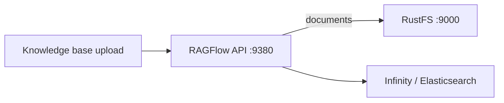
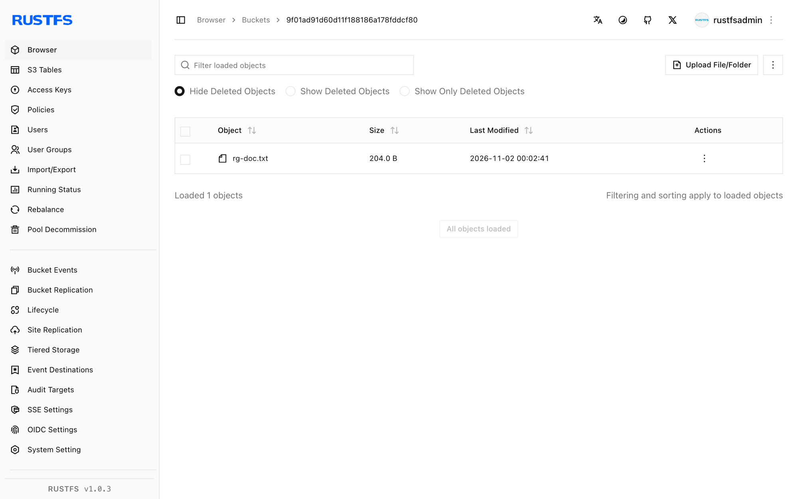

This guide connects [RAGFlow](https://github.com/infiniflow/ragflow) — the open-source RAG engine — to **RustFS** as its object storage. RAGFlow stores every uploaded document and parsed artifact in S3-compatible storage through its MinIO-compatible client configuration. You will point that configuration at RustFS, start the stack, upload a document into a knowledge base, and confirm the object in the bucket. The workflow was verified with `infiniflow/ragflow:v1.0.0-rc3` using the Infinity document engine.

You need Docker Compose. This deployment is intended for local integration testing, not production.

## Architecture



Each tenant gets a bucket named after its tenant ID, and every uploaded file becomes an object under that bucket. Parsing writes further artifacts next to the source document.

## 1. Configure the stack for RustFS

Clone RAGFlow and edit `docker/.env`. Select the Infinity document engine and point the storage client at RustFS:

```ini title="docker/.env"
DOC_ENGINE=infinity
MINIO_HOST=<your-rustfs-endpoint>
MINIO_USER=<your-access-key>
MINIO_PASSWORD=<your-secret-key>
```

The `minio:` section of `docker/service_conf.yaml.template` renders from these variables, so the same fields drive any S3-compatible endpoint. RAGFlow creates one bucket per tenant automatically — you do not need to pre-create it.

:::note[Give the RustFS container a network alias]

The Compose stack runs in its own bridge network, and Docker isolates bridges from each other, so the RustFS container's `172.17.0.x` address is unreachable from the stack. Attach RustFS to the Compose network with an alias and use the alias as `MINIO_HOST`:

```bash
docker network connect --alias rustfs ragflow_ragflow <rustfs-container>
```

Also replace the bundled MinIO image (pulled from quay.io) if your registry blocks it — the stack never talks to it when `MINIO_HOST` points elsewhere.

:::

## 2. Start the stack

```bash
cd ragflow/docker
docker compose -p ragflow up -d
```

Wait for the API to come up, then confirm the storage configuration the server loaded:

```bash
docker logs ragflow-cpu 2>&1 | grep "minio:"
```

```text
minio: {'user': '...', 'password': '...', 'host': 'rustfs:9000', 'bucket': '', 'prefix_path': ''}
```

An empty `bucket` is expected: RAGFlow creates one bucket per tenant on first upload.

## 3. Upload a document into a knowledge base

Create a user and an API key (from the web UI at `https://localhost:443`, or through the user API), then use the HTTP API:

```bash
curl -s -X POST http://localhost:9380/api/v1/datasets \
  -H "Authorization: Bearer <your-api-key>" -H "Content-Type: application/json" \
  -d '{"name":"rustfs-kb"}'

curl -s -X POST "http://localhost:9380/api/v1/datasets/<dataset-id>/documents" \
  -H "Authorization: Bearer <your-api-key>" \
  -F "file=@rustfs-overview.txt"
```

```json
{"code":0,"data":[{"chunk_method":"naive","location":"rustfs-overview.txt","name":"rustfs-overview.txt","run":"UNSTART"}]}
```

Confirm the object landed in RustFS — the tenant bucket is named after the tenant ID:

```bash
aws s3 ls s3://<tenant-id>/ --recursive \
  --endpoint-url http://<your-rustfs-endpoint>:9000
```

```text
2026-11-01 16:02:41        204 rg-doc.txt
```

Read the object back and compare it with the uploaded file:

```bash
aws s3 cp s3://<tenant-id>/rg-doc.txt - \
  --endpoint-url http://<your-rustfs-endpoint>:9000
```



## 4. Parse and retrieve

Document parsing (`PUT /api/v1/datasets/{id}/documents/{doc_id}` with `{"run":"parse"}`) consumes the stored object from RustFS and writes chunk artifacts next to it. Parsing additionally requires an embedding model configured in RAGFlow — that step depends on your model setup, not on storage.

## 5. Stop or reset

To tear down the stack while keeping the bucket objects:

```bash
docker compose -p ragflow stop
```

To delete the tenant data:

```bash
aws s3 rm s3://<tenant-id> --recursive \
  --endpoint-url http://<your-rustfs-endpoint>:9000
```

## Troubleshooting

### Upload succeeds but nothing appears in RustFS

The server is still talking to the bundled MinIO. Check the `minio:` line in the startup log — if the host is not your RustFS alias, the `.env` edit did not reach the container; recreate it with `docker compose -p ragflow up -d --force-recreate ragflow-cpu`.

### `tcp connect error: Connection timed out` on startup

The RustFS container address is not routable from the Compose network. Attach RustFS to the Compose network with an alias as shown in step 1 and use the alias in `MINIO_HOST`.

### `Authentication error: API key is invalid!` on `/api/v1`

The `/api/v1` SDK routes accept a RAGFlow API key (created in the web UI), not the login access token. `/v1/*` routes take the login session instead.

### Password errors on register or login

RAGFlow expects the password encrypted with its bundled RSA public key before it reaches the API — the web UI does this for you. Use the UI for account creation unless you replicate the client-side encryption.

## Next steps

- Review [S3 compatibility notes](/administration/protocols/s3) before enabling large-scale ingestion.
- Create dedicated production credentials with [Access Key Management](/security-compliance/iam/access-token).
- Follow the [RAGFlow documentation](https://ragflow.io/docs/dev/) for chunk templates, embedding models, and agent workflows on the same bucket.
