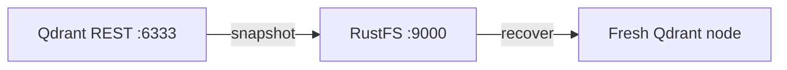

This guide connects [Qdrant](https://github.com/qdrant/qdrant) — the open-source vector database for AI search and RAG — to **RustFS** as its snapshot storage. You will enable S3-backed snapshots, create a collection with vectors, upload a snapshot into the bucket, and recover it onto a fresh node. The workflow was verified with `qdrant/qdrant:v1.20.0` storing snapshots in a RustFS bucket over path-style addressing.

You need Docker. This deployment is intended for local integration testing, not production.

## Architecture



With `snapshots_storage: s3`, every collection snapshot is uploaded to the bucket under `<prefix>/snapshots/<collection>/`, so a new node pointed at the same bucket can rebuild any collection without local files.

## 1. Point Qdrant at RustFS

Configure the snapshot storage through environment variables — the `QDRANT__` prefix maps to the config tree, and `S3_CONFIG__ENDPOINT_URL` is the custom-endpoint field for MinIO-class stores. Bucket and prefix must exist considerations: create the bucket first if it does not exist; the prefix may be empty.

```bash
docker run -d --name qdrant -p 6333:6333 \
  -e QDRANT__STORAGE__SNAPSHOTS_CONFIG__SNAPSHOTS_STORAGE=s3 \
  -e QDRANT__STORAGE__SNAPSHOTS_CONFIG__S3_CONFIG__BUCKET=my-bucket \
  -e QDRANT__STORAGE__SNAPSHOTS_CONFIG__S3_CONFIG__PREFIX=qdrant \
  -e QDRANT__STORAGE__SNAPSHOTS_CONFIG__S3_CONFIG__REGION=us-east-1 \
  -e QDRANT__STORAGE__SNAPSHOTS_CONFIG__S3_CONFIG__ACCESS_KEY=<your-access-key> \
  -e QDRANT__STORAGE__SNAPSHOTS_CONFIG__S3_CONFIG__SECRET_KEY=<your-secret-key> \
  -e QDRANT__STORAGE__SNAPSHOTS_CONFIG__S3_CONFIG__ENDPOINT_URL=http://<your-rustfs-endpoint>:9000 \
  qdrant/qdrant:v1.20.0
```

:::note[Use the QDRANT__STORAGE__SNAPSHOTS_CONFIG path]

In released Qdrant versions the settings live under `storage.snapshots_config` (not `storage.snapshots`), and the s3 section key is `endpoint_url`. A mounted `custom_config.yaml` with the older key names is silently ignored — snapshots keep going to the local `./snapshots` directory. Verify the storage switch by checking that the local directory stays empty after a snapshot.

:::

## 2. Create a collection and snapshot it

Create a collection, insert points, and request a snapshot:

```bash
curl -s -X PUT http://localhost:6333/collections/demo \
  -H "Content-Type: application/json" \
  -d '{"vectors":{"size":4,"distance":"Dot"}}'

curl -s -X PUT "http://localhost:6333/collections/demo/points?wait=true" \
  -H "Content-Type: application/json" \
  -d '{"points":[{"id":1,"vector":[0.1,0.2,0.3,0.4],"payload":{"city":"Berlin"}},{"id":2,"vector":[0.9,0.8,0.7,0.6],"payload":{"city":"Tokyo"}}]}'

curl -s -X POST http://localhost:6333/collections/demo/snapshots
```

```json
{"result":{"name":"demo-8437507706552082-2026-11-01-13-31-15-0.snapshot","size":64512},"status":"ok"}
```

Confirm the snapshot object landed in RustFS, replacing all connection placeholders:

```bash
aws s3 ls s3://my-bucket/qdrant/ --recursive \
  --endpoint-url http://<your-rustfs-endpoint>:9000
```

```text
2026-11-01 13:31:15  64512 qdrant/snapshots/demo/demo-8437507706552082-2026-11-01-13-31-15-0.snapshot
```


## 3. Recover onto a fresh node

A snapshot recovers into a collection with the same name. Wipe the local node (or start a second one) pointed at the same bucket, download the snapshot from RustFS, and upload it through the recovery API:

```bash
aws s3 cp "s3://my-bucket/qdrant/snapshots/demo/demo-8437507706552082-2026-11-01-13-31-15-0.snapshot" . \
  --endpoint-url http://<your-rustfs-endpoint>:9000

curl -s -X POST "http://localhost:6333/collections/demo/snapshots/upload?priority=snapshot" \
  -F "snapshot=@demo-8437507706552082-2026-11-01-13-31-15-0.snapshot"
```

Verify the recovered data:

```bash
curl -s -X POST http://localhost:6333/collections/demo/points/scroll \
  -H "Content-Type: application/json" -d '{"limit":2,"with_payload":true}'
```

```json
{"result":{"points":[{"id":1,"payload":{"city":"Berlin"}},{"id":2,"payload":{"city":"Tokyo"}}]},"status":"ok"}
```

Both vectors and payloads come back from the snapshot that RustFS stored.

## 4. Stop or reset

To tear down the demo while keeping the snapshot objects:

```bash
docker rm -f qdrant
```

To delete the stored snapshots:

```bash
aws s3 rm s3://my-bucket/qdrant --recursive \
  --endpoint-url http://<your-rustfs-endpoint>:9000
```

## Troubleshooting

### Snapshots still appear under `/qdrant/snapshots` in the container

The storage switch did not apply — either the env var path is wrong or an old config file overrides it. Use exactly the `QDRANT__STORAGE__SNAPSHOTS_CONFIG__*` variables from step 1 and restart the container; then confirm the local snapshot directory stays empty.

### `Wrong input: Snapshot is not compatible with existing collection`

The target collection already exists with a different schema. Delete the empty or stale collection before recovering — the upload API creates the collection from the snapshot.

### Bucket listing shows nothing after a snapshot

The bucket name or endpoint is wrong. The endpoint must include the scheme, and the bucket must exist; the object key is `<prefix>/snapshots/<collection>/<name>.snapshot`, so list recursively.

## Next steps

- Review [S3 compatibility notes](/administration/protocols/s3) before scheduling snapshot backups.
- Create dedicated production credentials with [Access Key Management](/security-compliance/iam/access-token).
- Follow the [Qdrant snapshots documentation](https://qdrant.tech/documentation/snapshots/) for full-storage snapshots, shard-level snapshots, and version compatibility on the same bucket.
