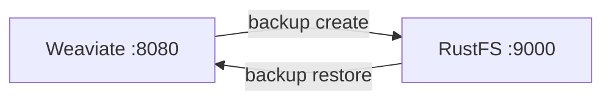

This guide connects [Weaviate](https://github.com/weaviate/weaviate) — the open-source vector database for AI search and RAG — to **RustFS** through its `backup-s3` module. You will enable the module, create a collection with vectors, create a backup in the bucket, and restore it. The workflow was verified with `semitechnologies/weaviate:1.31.0` backing up to a RustFS bucket.

You need Docker. This deployment is intended for local integration testing, not production.

## Architecture



A backup writes `backup_config.json`, per-class `backup.json`, and data chunks into the bucket prefix `<backup-id>/`. Restore reads them back into the same collection names.

## 1. Enable the backup-s3 module

Start Weaviate with the module and its S3 settings. Credentials go through the standard AWS variables — in Weaviate 1.31 the module reads `AWS_ACCESS_KEY_ID` and `AWS_SECRET_ACCESS_KEY`, not `BACKUP_S3_ACCESS_KEY_ID`:

```bash
docker run -d --name weaviate -p 8080:8080 \
  -e QUERY_DEFAULTS_LIMIT=20 \
  -e AUTHENTICATION_ANONYMOUS_ACCESS_ENABLED=true \
  -e PERSISTENCE_DATA_PATH=/var/lib/weaviate \
  -e ENABLE_MODULES=backup-s3 \
  -e BACKUP_S3_BUCKET=my-bucket \
  -e AWS_REGION=us-east-1 \
  -e AWS_ACCESS_KEY_ID=<your-access-key> \
  -e AWS_SECRET_ACCESS_KEY=<your-secret-key> \
  -e BACKUP_S3_ENDPOINT=<your-rustfs-endpoint>:9000 \
  -e BACKUP_S3_USE_SSL=false \
  -e CLUSTER_HOSTNAME=weaviate-demo \
  semitechnologies/weaviate:1.31.0
```

:::note[Endpoint format and credentials]

`BACKUP_S3_ENDPOINT` takes host and port without a scheme — the AWS SDK Go v1 client behind the module rejects `http://...` values with `Endpoint url cannot have fully qualified paths`. TLS is controlled by `BACKUP_S3_USE_SSL=false`, and requests are path-style. Passing `BACKUP_S3_ACCESS_KEY_ID` instead of `AWS_ACCESS_KEY_ID` leaves the client anonymous, and every backup call fails with `Access Denied`.

:::

Confirm the module is live:

```bash
curl -s http://localhost:8080/v1/meta | grep -o "backup-s3"
```

## 2. Create a collection and back it up

Schema creation uses `POST /v1/schema` in Weaviate 1.31. Insert two objects, then start a backup:

```bash
curl -s -X POST http://localhost:8080/v1/schema \
  -H "Content-Type: application/json" \
  -d '{"class":"Doc","vectorizer":"none","properties":[{"name":"title","dataType":["text"]}]}'

curl -s -X POST http://localhost:8080/v1/objects -H "Content-Type: application/json" \
  -d '{"class":"Doc","properties":{"title":"RustFS vector backup"},"vector":[0.11,0.22,0.33,0.44]}'

curl -s -X POST http://localhost:8080/v1/backups/s3 -H "Content-Type: application/json" \
  -d '{"id":"rustfs-demo"}'
```

```json
{"backend":"s3","classes":["Doc"],"id":"rustfs-demo","path":"s3://my-bucket/rustfs-demo","status":"STARTED"}
```

Wait for `SUCCESS`, then confirm the objects in RustFS, replacing all connection placeholders:

```bash
curl -s http://localhost:8080/v1/backups/s3/rustfs-demo
aws s3 ls s3://my-bucket/rustfs-demo/ --recursive \
  --endpoint-url http://<your-rustfs-endpoint>:9000
```

```text
2026-11-01 13:46:10        304 rustfs-demo/backup_config.json
2026-11-01 13:46:08       1406 rustfs-demo/weaviate-demo/Doc/chunk-1
2026-11-01 13:46:08      27666 rustfs-demo/weaviate-demo/backup.json
```


## 3. Restore

Restore the backup into Weaviate (drop the live class first for a clean restore):

```bash
curl -s -X POST http://localhost:8080/v1/backups/s3/rustfs-demo/restore \
  -H "Content-Type: application/json" -d '{}'
```

Query the restored data:

```bash
curl -s -X POST http://localhost:8080/v1/graphql -H "Content-Type: application/json" \
  -d '{"query":"{Get{Doc(limit:2){title}}}"}'
```

```json
{"data":{"Get":{"Doc":[{"title":"RustFS vector backup"},{"title":"Weaviate on object storage"}]}}}
```

## 4. Stop or reset

To tear down the demo while keeping the bucket objects:

```bash
docker rm -f weaviate
```

To delete the stored backup:

```bash
aws s3 rm s3://my-bucket/rustfs-demo --recursive \
  --endpoint-url http://<your-rustfs-endpoint>:9000
```

## Troubleshooting

### `Endpoint url cannot have fully qualified paths` at startup

`BACKUP_S3_ENDPOINT` contains a scheme. Use the bare `host:port` form and set `BACKUP_S3_USE_SSL=false`.

### `Access Denied` when creating a backup

The module found no credentials. In Weaviate 1.31 the S3 client reads `AWS_ACCESS_KEY_ID` and `AWS_SECRET_ACCESS_KEY` (or `AWS_ACCESS_KEY`/`AWS_SECRET_KEY`) from the environment — the `BACKUP_S3_ACCESS_KEY_ID` variable alone is not enough.

### `s3://my-bucket/s3Path/...` appears in the error

`BACKUP_S3_PATH` is a bucket sub-prefix in this version, not a path-style switch — do not set it to `s3Path`. Weaviate's S3 client uses path-style addressing automatically for custom endpoints.

### `check if backup ... exists` fails with an unexpected error

RustFS is unreachable from the container. Confirm the endpoint host resolves and the bucket exists.

## Next steps

- Review [S3 compatibility notes](/administration/protocols/s3) before automating backup schedules.
- Create dedicated production credentials with [Access Key Management](/security-compliance/iam/access-token).
- Follow the [Weaviate backups documentation](https://docs.weaviate.io/deploy/configuration/backups) for restore filters, role-based backups, and filesystem alternatives on the same bucket.
