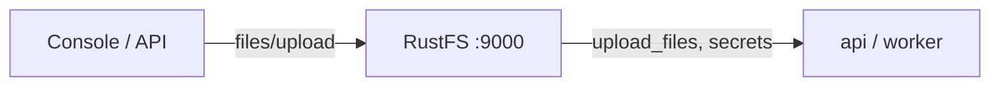

Ce guide connecte [Dify](https://github.com/langgenius/dify) — la plateforme open source d'applications LLM — à **RustFS** via son backend de stockage OpenDAL. Vous allez basculer le stockage de fichiers du disque local vers un bucket RustFS, démarrer la pile, téléverser un document dans une base de connaissances et confirmer l'objet dans le bucket. Le workflow a été vérifié avec Dify `1.18.0` sous Docker Compose.

Vous avez besoin de Docker Compose. Ce déploiement est destiné aux tests d'intégration locaux, pas à la production.

## Architecture



Dify persiste les documents téléversés, les fichiers de bases de connaissances et son secret d'amorçage (`.dify_secret_key`, clés de workspace) via le backend de stockage configuré. Quand le backend est un bucket, rien de tout cela ne réside sur les disques des conteneurs.

## 1. Configurer le stockage pour RustFS

Dans `docker/.env` (copié depuis `.env.example`), passez OpenDAL au schéma S3 :

```ini title="docker/.env"
STORAGE_TYPE=opendal
OPENDAL_SCHEME=s3
OPENDAL_S3_ENDPOINT=http://<your-rustfs-endpoint>:9000
OPENDAL_S3_BUCKET=dify
OPENDAL_S3_ACCESS_KEY_ID=<your-access-key>
OPENDAL_S3_SECRET_ACCESS_KEY=<your-secret-key>
OPENDAL_S3_REGION=us-east-1
OPENDAL_S3_ENABLE_PATH_STYLE=true
OPENDAL_S3_ROOT=/
```

Créez le bucket avant de démarrer la pile :

```bash
aws s3 mb s3://dify --endpoint-url http://<your-rustfs-endpoint>:9000
```

:::note[Rattacher RustFS au réseau Compose]

La pile Compose vit dans son propre réseau bridge, et Docker isole les bridges entre eux — un endpoint comme `http://172.17.0.2:9000` expire depuis le conteneur `api`. Rattachez le conteneur RustFS au réseau Compose avec un alias et utilisez l'alias comme hôte du endpoint :

```bash
docker network connect --alias rustfs <compose-network> <rustfs-container>
```

Recréez la pile après avoir modifié `.env` — `docker compose restart` conserve les anciennes variables d'environnement.

:::

## 2. Démarrer la pile et l'initialiser

```bash
cd dify/docker
docker compose up -d
```

Attendez le health-check de l'`api`, puis créez le compte administrateur dans l'interface web (`http://localhost:80`). Dify écrit immédiatement son état d'amorçage dans le bucket :

```bash
aws s3 ls s3://dify/ --recursive \
  --endpoint-url http://<your-rustfs-endpoint>:9000
```

```text
2026-11-01 14:31:00         65 .dify_secret_key
2026-11-01 14:33:06       1674 privkeys/<tenant-id>/private.pem
```

La clé secrète et les clés du workspace vivent désormais dans RustFS — les conteneurs ne détiennent aucun état important.

## 3. Téléverser un document dans une base de connaissances

Créez une base de connaissances dans l'interface, puis téléversez un document. Le téléversement atterrit dans le bucket sous `upload_files/<tenant-id>/` :

```bash
aws s3 ls s3://dify/upload_files/ --recursive \
  --endpoint-url http://<your-rustfs-endpoint>:9000
```

```text
2026-11-01 15:25:53        128 upload_files/<tenant-id>/0ae369a1-70ed-40e8-b3d9-0f12d0b7c699.txt
```

L'objet apparaît dès la fin du téléversement — l'indexation s'exécute sur la copie du bucket.


## 4. Arrêter ou réinitialiser

Pour arrêter la pile en conservant les objets du bucket :

```bash
docker compose down
```

Pour supprimer les données Dify :

```bash
aws s3 rm s3://dify --recursive \
  --endpoint-url http://<your-rustfs-endpoint>:9000
```

:::warning[Vider les bind mounts lors d'une réinitialisation]

Le fichier Compose de Dify monte par liaison sa base de données et son stockage sous `docker/volumes/`. `docker compose down -v` ne supprime pas les bind mounts — supprimez explicitement `docker/volumes/` pour repartir proprement, sinon l'ancien compte admin et l'état de chiffrement survivent.

:::

## Dépannage

### Les journaux de démarrage montrent `tcp connect error: Connection timed out` vers le bucket

La pile n'atteint pas l'adresse RustFS — isolation réseau entre bridges Docker. Rattachez RustFS au réseau Compose avec un alias comme à l'étape 1.

### La connexion échoue avec `Invalid encrypted data`

Le champ du mot de passe administrateur est encodé en Base64 par le frontend ; un mot de passe brut via l'API console échoue. Utilisez l'interface web pour les opérations de compte, ou encodez le champ comme le fait le frontend.

### `Default model not found for text-embedding` à la création de documents

Le mode d'indexation `high-quality` exige un fournisseur de modèle d'embedding configuré dans Dify. Utilisez l'indexation `economy` pour un test de stockage seul, ou configurez d'abord un fournisseur de modèles.

### Les téléversements arrivent toujours sur le disque local

Les conteneurs `api` et `worker` datent d'avant la modification du `.env`. Recréez toute la pile avec `docker compose up -d --force-recreate` pour que chaque service lise la nouvelle configuration de stockage.

## Prochaines étapes

- Consultez les [notes de compatibilité S3](/administration/protocols/s3) avant d'élargir vos bases de connaissances.
- Créez des identifiants de production dédiés avec la [gestion des clés d'accès](/security-compliance/iam/access-token).
- Suivez la [référence des variables d'environnement Dify](https://docs.dify.ai/en/self-host/deploy/configuration/environments) pour les réglages S3 séparés du démon de plugins et le réglage multipart sur le même bucket.
