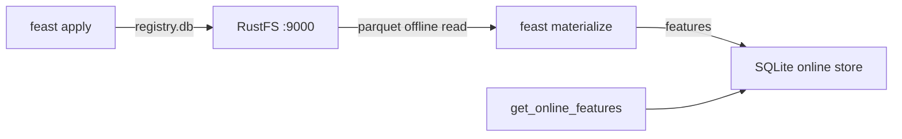

Ce guide connecte [Feast](https://github.com/feast-dev/feast) — le feature store open source — à **RustFS** dans deux rôles de stockage simultanés : le registre de features (`registry.db`) vit dans un bucket, et la source de features hors ligne est un fichier Parquet dans le même bucket. Vous allez appliquer un dépôt de features, matérialiser les features depuis RustFS vers le store en ligne, puis les relire. Le workflow a été vérifié avec Feast `0.67.0`.

Vous avez besoin de Python 3.10+. Ce déploiement est destiné aux tests d'intégration locaux, pas à la production.

## Architecture



Le store de registre lit et écrit `registry.db` dans le bucket via boto3, et le store hors ligne fichier lit le Parquet via s3fs — les deux honorent des endpoints personnalisés, si bien que toute la couche d'historique des features est adossée au bucket tandis que le store en ligne reste local.

## 1. Installer Feast avec le support S3

Le paquet de base omet les clients S3 ; installez-les explicitement :

```bash
python3 -m venv .venv
./.venv/bin/pip install feast boto3 s3fs
```

Téléversez les données de features hors ligne, en remplaçant tous les paramètres fictifs :

```bash
aws s3 cp driver_stats.parquet s3://my-bucket/feast/driver_stats.parquet \
  --endpoint-url http://<your-rustfs-endpoint>:9000
```

## 2. Configurer le dépôt

Créez les fichiers du dépôt. Le registre est une simple URI `s3://` et la substitution d'endpoint provient de la variable d'environnement `FEAST_S3_ENDPOINT_URL` ; la source de données porte son propre `s3_endpoint_override` :

```yaml title="feature_store.yaml"
project: rustfs_demo
provider: local
registry: s3://my-bucket/feast/registry.db
offline_store:
  type: file
entity_key_serialization_version: 3
```

```python title="features.py"
from datetime import timedelta
from feast import Entity, FeatureView, Field, FileSource
from feast.types import Float32, Int64

driver = Entity(name="driver", join_keys=["driver_id"])
source = FileSource(
    name="driver_stats_source",
    path="s3://my-bucket/feast/driver_stats.parquet",
    timestamp_field="event_timestamp",
    s3_endpoint_override="http://<your-rustfs-endpoint>:9000",
)
driver_stats = FeatureView(
    name="driver_stats",
    entities=[driver],
    ttl=timedelta(days=1),
    schema=[Field(name="conv_rate", dtype=Float32), Field(name="avg_daily_trips", dtype=Int64)],
    source=source,
)
```

Exportez l'endpoint et les identifiants pour le client du registre :

```bash
export FEAST_S3_ENDPOINT_URL=http://<your-rustfs-endpoint>:9000
export AWS_ACCESS_KEY_ID=<your-access-key>
export AWS_SECRET_ACCESS_KEY=<your-secret-key>
export AWS_DEFAULT_REGION=us-east-1
```

## 3. Appliquer le dépôt et matérialiser

`feast apply` écrit `registry.db` dans le bucket ; `materialize-incremental` lit les features Parquet depuis RustFS vers le store en ligne local :

```bash
./.venv/bin/feast apply
./.venv/bin/feast materialize-incremental 2026-11-02T00:00:00Z
```

```text
Created entity driver
Created feature view driver_stats
...
driver_stats from 2026-10-31 ... to 2026-11-02 00:00:00+00:00:
```

Confirmez l'objet du registre dans RustFS :

```bash
aws s3 ls s3://my-bucket/feast/ \
  --endpoint-url http://<your-rustfs-endpoint>:9000
```

```text
2026-11-01 13:57:58       1322 registry.db
2026-11-01 13:56:43       3680 driver_stats.parquet
```


## 4. Relire les features

```bash
./.venv/bin/python - <<'PY'
from feast import FeatureStore
store = FeatureStore(repo_path=".")
res = store.get_online_features(
    features=["driver_stats:conv_rate", "driver_stats:avg_daily_trips"],
    entity_rows=[{"driver_id": 101}],
).to_dict()
print("conv_rate:", res["conv_rate"][0])
print("avg_daily_trips:", res["avg_daily_trips"][0])
PY
```

```text
conv_rate: 0.699999988079071
avg_daily_trips: 130
```

Les features servies ont été matérialisées depuis le fichier Parquet que RustFS stocke.

## 5. Arrêter ou réinitialiser

Supprimer les objets du dépôt :

```bash
aws s3 rm s3://my-bucket/feast --recursive \
  --endpoint-url http://<your-rustfs-endpoint>:9000
```

## Dépannage

### `Could not import module 'feast.infra.registry.s3'`

Le store de registre S3 a besoin de `boto3`, que le paquet Feast de base n'installe pas. `pip install boto3` (et `s3fs` pour le store hors ligne) résout le problème.

### `Install s3fs to access S3` pendant la matérialisation

Le store hors ligne fichier lit le Parquet via `s3fs`. Installez-le avec `boto3` comme à l'étape 1.

### Le store de registre S3 ignore l'endpoint

Le registre ne lit son endpoint que depuis la variable d'environnement `FEAST_S3_ENDPOINT_URL` — un simple `AWS_ENDPOINT_URL` n'y est pas honoré. La `FileSource` porte son propre `s3_endpoint_override` ; les deux sont nécessaires.

### Un avertissement de dépréciation sur la sérialisation des clés d'entité

Réglez `entity_key_serialization_version: 3` dans `feature_store.yaml` — les versions inférieures à 3 sont refusées pour les nouveaux stores en ligne.

## Prochaines étapes

- Consultez les [notes de compatibilité S3](/administration/protocols/s3) avant de pointer des registres de production vers le bucket.
- Créez des identifiants de production dédiés avec la [gestion des clés d'accès](/security-compliance/iam/access-token).
- Suivez la [documentation Feast](https://docs.feast.dev/) pour les sources en flux, le service de features et les alternatives de registre sur le même bucket.
