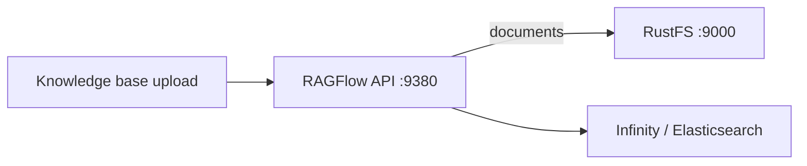

Ce guide connecte [RAGFlow](https://github.com/infiniflow/ragflow) — le moteur RAG open source — à **RustFS** comme stockage objet. RAGFlow place chaque document téléversé et chaque artefact d'analyse dans un stockage compatible S3 via sa configuration client compatible MinIO. Vous allez pointer cette configuration vers RustFS, démarrer la pile, téléverser un document dans une base de connaissances et confirmer l'objet dans le bucket. Le workflow a été vérifié avec `infiniflow/ragflow:v1.0.0-rc3` et le moteur de documents Infinity.

Vous avez besoin de Docker Compose. Ce déploiement est destiné aux tests d'intégration locaux, pas à la production.

## Architecture



Chaque tenant obtient un bucket nommé d'après son identifiant de tenant, et chaque fichier téléversé devient un objet dans ce bucket. L'analyse écrit des artefacts supplémentaires à côté du document source.

## 1. Configurer la pile pour RustFS

Clonez RAGFlow et modifiez `docker/.env`. Choisissez le moteur de documents Infinity et pointez le client de stockage vers RustFS :

```ini title="docker/.env"
DOC_ENGINE=infinity
MINIO_HOST=<your-rustfs-endpoint>
MINIO_USER=<your-access-key>
MINIO_PASSWORD=<your-secret-key>
```

La section `minio:` de `docker/service_conf.yaml.template` est rendue à partir de ces variables — les mêmes champs pilotent n'importe quel endpoint compatible S3. RAGFlow crée automatiquement un bucket par tenant au premier téléversement ; inutile de le créer au préalable.

:::note[Donner un alias réseau au conteneur RustFS]

La pile Compose vit dans son propre réseau bridge, et Docker isole les bridges entre eux — l'adresse `172.17.0.x` du conteneur RustFS est injoignable depuis la pile. Rattachez RustFS au réseau Compose avec un alias et utilisez l'alias comme `MINIO_HOST` :

```bash
docker network connect --alias rustfs ragflow_ragflow <rustfs-container>
```

Remplacez aussi l'image MinIO fournie (tirée de quay.io) si votre registre la bloque — la pile ne lui parle pas quand `MINIO_HOST` pointe ailleurs.

:::

## 2. Démarrer la pile

```bash
cd ragflow/docker
docker compose -p ragflow up -d
```

Attendez que l'API démarre, puis confirmez la configuration de stockage chargée par le serveur :

```bash
docker logs ragflow-cpu 2>&1 | grep "minio:"
```

```text
minio: {'user': '...', 'password': '...', 'host': 'rustfs:9000', 'bucket': '', 'prefix_path': ''}
```

Un `bucket` vide est attendu : RAGFlow crée un bucket par tenant au premier téléversement.

## 3. Téléverser un document dans une base de connaissances

Créez un utilisateur et une clé API (depuis l'interface web sur `https://localhost:443`, ou via l'API utilisateur), puis utilisez l'API HTTP :

```bash
curl -s -X POST http://localhost:9380/api/v1/datasets \
  -H "Authorization: Bearer <your-api-key>" -H "Content-Type: application/json" \
  -d '{"name":"rustfs-kb"}'

curl -s -X POST "http://localhost:9380/api/v1/datasets/<dataset-id>/documents" \
  -H "Authorization: Bearer <your-api-key>" \
  -F "file=@rustfs-overview.txt"
```

```json
{"code":0,"data":[{"chunk_method":"naive","location":"rustfs-overview.txt","name":"rustfs-overview.txt","run":"UNSTART"}]}
```

Confirmez que l'objet a atterri dans RustFS — le bucket du tenant porte son identifiant :

```bash
aws s3 ls s3://<tenant-id>/ --recursive \
  --endpoint-url http://<your-rustfs-endpoint>:9000
```

```text
2026-11-01 16:02:41        204 rg-doc.txt
```

Relisez l'objet et comparez-le au fichier téléversé :

```bash
aws s3 cp s3://<tenant-id>/rg-doc.txt - \
  --endpoint-url http://<your-rustfs-endpoint>:9000
```


## 4. Analyser et récupérer

L'analyse des documents (`PUT /api/v1/datasets/{id}/documents/{doc_id}` avec `{"run":"parse"}`) consomme l'objet stocké depuis RustFS et écrit les artefacts de chunks à côté. L'analyse nécessite en outre un modèle d'embedding configuré dans RAGFlow — cette étape dépend de votre configuration de modèles, pas du stockage.

## 5. Arrêter ou réinitialiser

Pour arrêter la pile en conservant les objets du bucket :

```bash
docker compose -p ragflow stop
```

Pour supprimer les données du tenant :

```bash
aws s3 rm s3://<tenant-id> --recursive \
  --endpoint-url http://<your-rustfs-endpoint>:9000
```

## Dépannage

### Le téléversement réussit mais rien n'apparaît dans RustFS

Le serveur parle encore au MinIO fourni. Consultez la ligne `minio:` du journal de démarrage — si l'hôte n'est pas votre alias RustFS, la modification du `.env` n'a pas atteint le conteneur ; recréez-le avec `docker compose -p ragflow up -d --force-recreate ragflow-cpu`.

### `tcp connect error: Connection timed out` au démarrage

L'adresse du conteneur RustFS n'est pas routable depuis le réseau Compose. Rattachez RustFS au réseau Compose avec un alias comme à l'étape 1 et utilisez l'alias dans `MINIO_HOST`.

### `Authentication error: API key is invalid!` sur `/api/v1`

Les routes SDK `/api/v1` acceptent une clé API RAGFlow (créée dans l'interface web), pas le jeton d'accès de connexion. Les routes `/v1/*` utilisent la session de connexion.

### Erreurs de mot de passe à l'inscription ou la connexion

RAGFlow attend le mot de passe chiffré avec sa clé publique RSA fournie avant d'atteindre l'API — l'interface web s'en charge. Utilisez l'interface pour créer les comptes, sauf à reproduire le chiffrement côté client.

## Prochaines étapes

- Consultez les [notes de compatibilité S3](/administration/protocols/s3) avant une ingestion à grande échelle.
- Créez des identifiants de production dédiés avec la [gestion des clés d'accès](/security-compliance/iam/access-token).
- Suivez la [documentation RAGFlow](https://ragflow.io/docs/dev/) pour les modèles de chunks, les modèles d'embedding et les workflows d'agents sur le même bucket.
