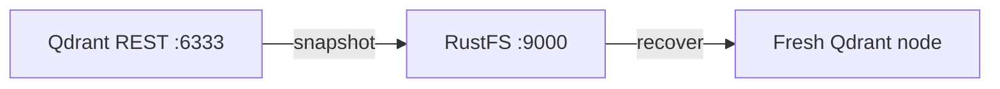

Ce guide connecte [Qdrant](https://github.com/qdrant/qdrant) — la base de données vectorielle open source pour la recherche IA et le RAG — à **RustFS** comme stockage de snapshots. Vous allez activer le stockage de snapshots S3, créer une collection avec des vecteurs, téléverser un snapshot dans le bucket, puis le restaurer sur un nœud neuf. Le workflow a été vérifié avec `qdrant/qdrant:v1.20.0` écrivant ses snapshots dans un bucket RustFS via l'adressage path-style.

Vous avez besoin de Docker. Ce déploiement est destiné aux tests d'intégration locaux, pas à la production.

## Architecture



Avec `snapshots_storage: s3`, chaque snapshot de collection est téléversé dans le bucket sous `<prefix>/snapshots/<collection>/` ; un nœud neuf pointant vers le même bucket peut reconstruire n'importe quelle collection sans fichiers locaux.

## 1. Pointer Qdrant vers RustFS

Configurez le stockage de snapshots via des variables d'environnement — le préfixe `QDRANT__` mappe l'arbre de configuration, et `S3_CONFIG__ENDPOINT_URL` est le champ de point de terminaison personnalisé pour les stockages de classe MinIO. Le bucket doit exister au préalable ; le préfixe peut être vide.

```bash
docker run -d --name qdrant -p 6333:6333 \
  -e QDRANT__STORAGE__SNAPSHOTS_CONFIG__SNAPSHOTS_STORAGE=s3 \
  -e QDRANT__STORAGE__SNAPSHOTS_CONFIG__S3_CONFIG__BUCKET=my-bucket \
  -e QDRANT__STORAGE__SNAPSHOTS_CONFIG__S3_CONFIG__PREFIX=qdrant \
  -e QDRANT__STORAGE__SNAPSHOTS_CONFIG__S3_CONFIG__REGION=us-east-1 \
  -e QDRANT__STORAGE__SNAPSHOTS_CONFIG__S3_CONFIG__ACCESS_KEY=<your-access-key> \
  -e QDRANT__STORAGE__SNAPSHOTS_CONFIG__S3_CONFIG__SECRET_KEY=<your-secret-key> \
  -e QDRANT__STORAGE__SNAPSHOTS_CONFIG__S3_CONFIG__ENDPOINT_URL=http://<your-rustfs-endpoint>:9000 \
  qdrant/qdrant:v1.20.0
```

:::note[Utiliser le chemin QDRANT__STORAGE__SNAPSHOTS_CONFIG]

Dans les versions publiées de Qdrant, les réglages vivent sous `storage.snapshots_config` (pas `storage.snapshots`), et la clé s3 du point de terminaison est `endpoint_url`. Un `custom_config.yaml` monté avec d'anciens noms de clés est ignoré silencieusement — les snapshots continuent d'aller dans le répertoire local `./snapshots`. Vérifiez la bascule en constatant que le répertoire local reste vide après un snapshot.

:::

## 2. Créer une collection et prendre un snapshot

Créez une collection, insérez des points, demandez un snapshot :

```bash
curl -s -X PUT http://localhost:6333/collections/demo \
  -H "Content-Type: application/json" \
  -d '{"vectors":{"size":4,"distance":"Dot"}}'

curl -s -X PUT "http://localhost:6333/collections/demo/points?wait=true" \
  -H "Content-Type: application/json" \
  -d '{"points":[{"id":1,"vector":[0.1,0.2,0.3,0.4],"payload":{"city":"Berlin"}},{"id":2,"vector":[0.9,0.8,0.7,0.6],"payload":{"city":"Tokyo"}}]}'

curl -s -X POST http://localhost:6333/collections/demo/snapshots
```

```json
{"result":{"name":"demo-8437507706552082-2026-11-01-13-31-15-0.snapshot","size":64512},"status":"ok"}
```

Confirmez que l'objet snapshot a atterri dans RustFS, en remplaçant tous les paramètres fictifs :

```bash
aws s3 ls s3://my-bucket/qdrant/ --recursive \
  --endpoint-url http://<your-rustfs-endpoint>:9000
```

```text
2026-11-01 13:31:15  64512 qdrant/snapshots/demo/demo-8437507706552082-2026-11-01-13-31-15-0.snapshot
```


## 3. Restaurer sur un nœud neuf

Un snapshot se restaure dans une collection de même nom. Réinitialisez le nœud local (ou démarrez-en un second) pointant vers le même bucket, téléchargez le snapshot depuis RustFS et passez-le à l'API de récupération :

```bash
aws s3 cp "s3://my-bucket/qdrant/snapshots/demo/demo-8437507706552082-2026-11-01-13-31-15-0.snapshot" . \
  --endpoint-url http://<your-rustfs-endpoint>:9000

curl -s -X POST "http://localhost:6333/collections/demo/snapshots/upload?priority=snapshot" \
  -F "snapshot=@demo-8437507706552082-2026-11-01-13-31-15-0.snapshot"
```

Vérifiez les données restaurées :

```bash
curl -s -X POST http://localhost:6333/collections/demo/points/scroll \
  -H "Content-Type: application/json" -d '{"limit":2,"with_payload":true}'
```

```json
{"result":{"points":[{"id":1,"payload":{"city":"Berlin"}},{"id":2,"payload":{"city":"Tokyo"}}]},"status":"ok"}
```

Vecteurs et payloads reviennent intégralement depuis le snapshot stocké par RustFS.

## 4. Arrêter ou réinitialiser

Pour démonter la démo tout en conservant les objets du bucket :

```bash
docker rm -f qdrant
```

Pour supprimer les snapshots stockés :

```bash
aws s3 rm s3://my-bucket/qdrant --recursive \
  --endpoint-url http://<your-rustfs-endpoint>:9000
```

## Dépannage

### Les snapshots apparaissent toujours sous `/qdrant/snapshots` dans le conteneur

La bascule de stockage n'a pas été appliquée — chemin de variable erroné ou ancien fichier de config qui écrase. Utilisez exactement les variables `QDRANT__STORAGE__SNAPSHOTS_CONFIG__*` de l'étape 1 et redémarrez le conteneur ; vérifiez ensuite que le répertoire local des snapshots reste vide.

### `Wrong input: Snapshot is not compatible with existing collection`

La collection cible existe déjà avec un schéma différent. Supprimez la collection vide ou périmée avant de restaurer — l'API de téléversement crée la collection à partir du snapshot.

### Le bucket reste vide après un snapshot

Nom de bucket ou endpoint erroné. L'endpoint doit inclure le schéma et le bucket doit exister ; la clé d'objet est `<prefix>/snapshots/<collection>/<name>.snapshot` — listez récursivement.

## Prochaines étapes

- Consultez les [notes de compatibilité S3](/administration/protocols/s3) avant de planifier des sauvegardes par snapshot.
- Créez des identifiants de production dédiés avec la [gestion des clés d'accès](/security-compliance/iam/access-token).
- Suivez la [documentation des snapshots Qdrant](https://qdrant.tech/documentation/snapshots/) pour les snapshots de stockage complet, les snapshots de shards et la compatibilité des versions sur le même bucket.
