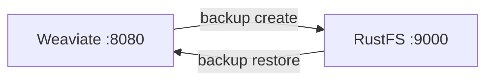

Ce guide connecte [Weaviate](https://github.com/weaviate/weaviate) — la base de données vectorielle open source pour la recherche IA et le RAG — à **RustFS** via son module `backup-s3`. Vous allez activer le module, créer une collection avec des vecteurs, créer une sauvegarde dans le bucket, puis la restaurer. Le workflow a été vérifié avec `semitechnologies/weaviate:1.31.0` sauvegardant dans un bucket RustFS.

Vous avez besoin de Docker. Ce déploiement est destiné aux tests d'intégration locaux, pas à la production.

## Architecture



Une sauvegarde écrit `backup_config.json`, un `backup.json` par classe et des blocs de données dans le préfixe du bucket `<backup-id>/`. La restauration les relit sous les mêmes noms de collection.

## 1. Activer le module backup-s3

Démarrez Weaviate avec le module et ses réglages S3. Les identifiants passent par les variables AWS standard — dans Weaviate 1.31, le module lit `AWS_ACCESS_KEY_ID` et `AWS_SECRET_ACCESS_KEY`, pas `BACKUP_S3_ACCESS_KEY_ID` :

```bash
docker run -d --name weaviate -p 8080:8080 \
  -e QUERY_DEFAULTS_LIMIT=20 \
  -e AUTHENTICATION_ANONYMOUS_ACCESS_ENABLED=true \
  -e PERSISTENCE_DATA_PATH=/var/lib/weaviate \
  -e ENABLE_MODULES=backup-s3 \
  -e BACKUP_S3_BUCKET=my-bucket \
  -e AWS_REGION=us-east-1 \
  -e AWS_ACCESS_KEY_ID=<your-access-key> \
  -e AWS_SECRET_ACCESS_KEY=<your-secret-key> \
  -e BACKUP_S3_ENDPOINT=<your-rustfs-endpoint>:9000 \
  -e BACKUP_S3_USE_SSL=false \
  -e CLUSTER_HOSTNAME=weaviate-demo \
  semitechnologies/weaviate:1.31.0
```

:::note[Format du endpoint et identifiants]

`BACKUP_S3_ENDPOINT` prend hôte et port sans schéma — le client AWS SDK Go v1 derrière le module rejette toute valeur `http://...` avec `Endpoint url cannot have fully qualified paths`. Le TLS est contrôlé par `BACKUP_S3_USE_SSL=false`, et les requêtes sont en path-style. Passer `BACKUP_S3_ACCESS_KEY_ID` au lieu de `AWS_ACCESS_KEY_ID` laisse le client anonyme, et chaque appel de sauvegarde échoue avec `Access Denied`.

:::

Confirmez que le module est actif :

```bash
curl -s http://localhost:8080/v1/meta | grep -o "backup-s3"
```

## 2. Créer une collection et la sauvegarder

Dans Weaviate 1.31, le schéma se crée par `POST /v1/schema`. Insérez deux objets, puis lancez la sauvegarde :

```bash
curl -s -X POST http://localhost:8080/v1/schema \
  -H "Content-Type: application/json" \
  -d '{"class":"Doc","vectorizer":"none","properties":[{"name":"title","dataType":["text"]}]}'

curl -s -X POST http://localhost:8080/v1/objects -H "Content-Type: application/json" \
  -d '{"class":"Doc","properties":{"title":"RustFS vector backup"},"vector":[0.11,0.22,0.33,0.44]}'

curl -s -X POST http://localhost:8080/v1/backups/s3 -H "Content-Type: application/json" \
  -d '{"id":"rustfs-demo"}'
```

```json
{"backend":"s3","classes":["Doc"],"id":"rustfs-demo","path":"s3://my-bucket/rustfs-demo","status":"STARTED"}
```

Attendez `SUCCESS`, puis confirmez les objets dans RustFS, en remplaçant tous les paramètres fictifs :

```bash
curl -s http://localhost:8080/v1/backups/s3/rustfs-demo
aws s3 ls s3://my-bucket/rustfs-demo/ --recursive \
  --endpoint-url http://<your-rustfs-endpoint>:9000
```

```text
2026-11-01 13:46:10        304 rustfs-demo/backup_config.json
2026-11-01 13:46:08       1406 rustfs-demo/weaviate-demo/Doc/chunk-1
2026-11-01 13:46:08      27666 rustfs-demo/weaviate-demo/backup.json
```


## 3. Restaurer

Restaurez la sauvegarde dans Weaviate (supprimez d'abord la classe en ligne pour une restauration propre) :

```bash
curl -s -X POST http://localhost:8080/v1/backups/s3/rustfs-demo/restore \
  -H "Content-Type: application/json" -d '{}'
```

Interrogez les données restaurées :

```bash
curl -s -X POST http://localhost:8080/v1/graphql -H "Content-Type: application/json" \
  -d '{"query":"{Get{Doc(limit:2){title}}}"}'
```

```json
{"data":{"Get":{"Doc":[{"title":"RustFS vector backup"},{"title":"Weaviate on object storage"}]}}}
```

## 4. Arrêter ou réinitialiser

Pour démonter la démo tout en conservant les objets du bucket :

```bash
docker rm -f weaviate
```

Pour supprimer la sauvegarde stockée :

```bash
aws s3 rm s3://my-bucket/rustfs-demo --recursive \
  --endpoint-url http://<your-rustfs-endpoint>:9000
```

## Dépannage

### `Endpoint url cannot have fully qualified paths` au démarrage

`BACKUP_S3_ENDPOINT` contient un schéma. Utilisez la forme `hôte:port` nue et réglez `BACKUP_S3_USE_SSL=false`.

### `Access Denied` à la création d'une sauvegarde

Le module n'a trouvé aucun identifiant. Dans Weaviate 1.31, le client S3 lit `AWS_ACCESS_KEY_ID` et `AWS_SECRET_ACCESS_KEY` (ou `AWS_ACCESS_KEY`/`AWS_SECRET_KEY`) dans l'environnement — la seule variable `BACKUP_S3_ACCESS_KEY_ID` ne suffit pas.

### `s3://my-bucket/s3Path/...` apparaît dans l'erreur

Dans cette version, `BACKUP_S3_PATH` est un sous-préfixe de bucket, pas un commutateur path-style — ne le réglez pas sur `s3Path`. Le client S3 de Weaviate utilise automatiquement le path-style pour les endpoints personnalisés.

### `check if backup ... exists` échoue avec une erreur inattendue

RustFS est injoignable depuis le conteneur. Vérifiez que l'hôte du endpoint se résout et que le bucket existe.

## Prochaines étapes

- Consultez les [notes de compatibilité S3](/administration/protocols/s3) avant d'automatiser les planifications de sauvegarde.
- Créez des identifiants de production dédiés avec la [gestion des clés d'accès](/security-compliance/iam/access-token).
- Suivez la [documentation des sauvegardes Weaviate](https://docs.weaviate.io/deploy/configuration/backups) pour les filtres de restauration, les sauvegardes par rôle et l'alternative système de fichiers sur le même bucket.
