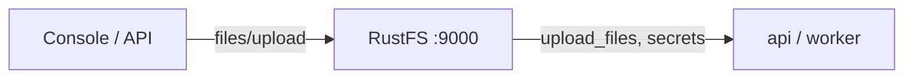

このガイドは、オープンソースの LLM アプリケーションプラットフォーム [Dify](https://github.com/langgenius/dify) を、OpenDAL ストレージバックエンド経由で **RustFS** に接続します。ファイルストレージをローカルディスクから RustFS バケットに切り替え、スタックを起動し、ナレッジベースにドキュメントをアップロードして、バケット内のオブジェクトを確認します。このワークフローは Dify `1.18.0`（Docker Compose）で検証しました。

Docker Compose が必要です。このデプロイはローカルでの結合テスト用であり、本番環境向けではありません。

## アーキテクチャ



Dify は、アップロードされた文書・ナレッジベースのファイル・ブートストラップシークレット（`.dify_secret_key`、ワークスペース鍵）を、設定されたストレージバックエンド経由で永続化します。バックエンドがバケットなら、これらはコンテナのディスクには残りません。

## 1. RustFS 向けにストレージを設定する

`docker/.env`（`.env.example` からコピー）で OpenDAL を S3 スキームに切り替えます：

```ini title="docker/.env"
STORAGE_TYPE=opendal
OPENDAL_SCHEME=s3
OPENDAL_S3_ENDPOINT=http://<your-rustfs-endpoint>:9000
OPENDAL_S3_BUCKET=dify
OPENDAL_S3_ACCESS_KEY_ID=<your-access-key>
OPENDAL_S3_SECRET_ACCESS_KEY=<your-secret-key>
OPENDAL_S3_REGION=us-east-1
OPENDAL_S3_ENABLE_PATH_STYLE=true
OPENDAL_S3_ROOT=/
```

スタック起動前にバケットを作成します：

```bash
aws s3 mb s3://dify --endpoint-url http://<your-rustfs-endpoint>:9000
```

:::note[RustFS を Compose ネットワークに接続する]

Compose スタックは独自のブリッジネットワークで動き、Docker はブリッジ同士を分離します。`http://172.17.0.2:9000` のようなエンドポイントは `api` コンテナからタイムアウトします。RustFS コンテナをエイリアス付きで Compose ネットワークに接続し、エンドポイントのホストにはエイリアスを使ってください：

```bash
docker network connect --alias rustfs <compose-network> <rustfs-container>
```

`.env` を変更した後はスタックを再作成してください。`docker compose restart` は古い環境変数を使い続けます。

:::

## 2. スタックを起動して初期化する

```bash
cd dify/docker
docker compose up -d
```

`api` のヘルスチェックが通るのを待ち、Web UI（`http://localhost:80`）で管理者アカウントを作成します。Dify は直ちにブートストラップ状態をバケットへ書き込みます：

```bash
aws s3 ls s3://dify/ --recursive \
  --endpoint-url http://<your-rustfs-endpoint>:9000
```

```text
2026-11-01 14:31:00         65 .dify_secret_key
2026-11-01 14:33:06       1674 privkeys/<tenant-id>/private.pem
```

シークレットキーとワークスペース鍵は RustFS 上にあります。コンテナには残すべき状態がありません。

## 3. ナレッジベースに文書をアップロードする

UI でナレッジベースを作成し、文書をアップロードします。アップロードはバケットの `upload_files/<tenant-id>/` の下に着地します：

```bash
aws s3 ls s3://dify/upload_files/ --recursive \
  --endpoint-url http://<your-rustfs-endpoint>:9000
```

```text
2026-11-01 15:25:53        128 upload_files/<tenant-id>/0ae369a1-70ed-40e8-b3d9-0f12d0b7c699.txt
```

オブジェクトはアップロード完了の瞬間に現れます。インデックス作成はバケット上のコピーに対して実行されます。


## 4. 停止またはリセット

バケットのオブジェクトを残したままスタックを解体するには：

```bash
docker compose down
```

Dify のデータを削除するには：

```bash
aws s3 rm s3://dify --recursive \
  --endpoint-url http://<your-rustfs-endpoint>:9000
```

:::warning[リセット時は bind mount も消す]

Dify の Compose ファイルはデータベースとストレージを `docker/volumes/` 以下にバインドマウントします。`docker compose down -v` はバインドマウントを削除しません。クリーンな状態にするには `docker/volumes/` を明示的に削除してください。そうしないと旧管理者アカウントと暗号化状態が残ります。

:::

## トラブルシューティング

### 起動ログがバケットに対して `tcp connect error: Connection timed out` を表示する

スタックから RustFS のアドレスに到達できていません。Docker ブリッジ間のネットワーク分離です。手順 1 のとおり RustFS をエイリアス付きで Compose ネットワークに接続してください。

### ログインが `Invalid encrypted data` で失敗する

管理者のパスワードフィールドはフロントエンドが Base64 エンコードします。console API に平文を送ると失敗します。アカウント操作には Web UI を使うか、フロントエンドと同じ方法でフィールドをエンコードしてください。

### 文書作成時に `Default model not found for text-embedding`

`high-quality` インデックスモードには Dify で設定済みの embedding モデルプロバイダーが必要です。ストレージだけの検証なら `economy` インデックスを使うか、先にモデルプロバイダーを設定してください。

### アップロードがローカルディスクに落ち続ける

`api` と `worker` コンテナが `.env` 変更前の古いインスタンスです。`docker compose up -d --force-recreate` でスタック全体を再作成し、全サービスに新しいストレージ設定を読ませてください。

## 次のステップ

- 大きなナレッジベースを運用する前に [S3 互換性についての注意](/administration/protocols/s3) を確認してください。
- [アクセスキー管理](/security-compliance/iam/access-token) で本番用の専用認証情報を作成してください。
- [Dify 環境変数リファレンス](https://docs.dify.ai/en/self-host/deploy/configuration/environments) に従い、プラグインデーモン固有の S3 設定や同じバケットでのマルチパート調整を活用してください。
