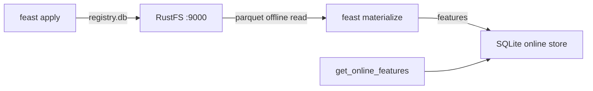

このガイドは、オープンソースのフィーチャーストア [Feast](https://github.com/feast-dev/feast) を **RustFS** に接続し、2 つのストレージ役割を同時に担わせます。フィーチャーレジストリ（`registry.db`）をバケットに置き、オフラインのフィーチャーソースを同じバケット内の Parquet ファイルにします。フィーチャーリポジトリを適用し、RustFS からフィーチャーをオンラインストアへマテリアライズして読み戻します。このワークフローは Feast `0.67.0` で検証しました。

Python 3.10 以上が必要です。このデプロイはローカルでの結合テスト用であり、本番環境向けではありません。

## アーキテクチャ



レジストリストアは boto3 でバケット内の `registry.db` を読み書きし、ファイルオフラインストアは s3fs で Parquet を読みます。どちらもカスタムエンドポイントを扱えるため、フィーチャー履歴レイヤー全体がバケット上にあり、オンラインストアだけがローカルに残ります。

## 1. S3 サポート付きの Feast をインストールする

ベースパッケージには S3 クライアントが含まれないため、明示的にインストールします：

```bash
python3 -m venv .venv
./.venv/bin/pip install feast boto3 s3fs
```

オフラインのフィーチャーデータをアップロードします。接続プレースホルダーをすべて置き換えてください：

```bash
aws s3 cp driver_stats.parquet s3://my-bucket/feast/driver_stats.parquet \
  --endpoint-url http://<your-rustfs-endpoint>:9000
```

## 2. リポジトリを設定する

リポジトリのファイルを作成します。レジストリは素の `s3://` URI で、エンドポイントの上書きは環境変数 `FEAST_S3_ENDPOINT_URL` から取得します。データソースは自身の `s3_endpoint_override` を持ちます：

```yaml title="feature_store.yaml"
project: rustfs_demo
provider: local
registry: s3://my-bucket/feast/registry.db
offline_store:
  type: file
entity_key_serialization_version: 3
```

```python title="features.py"
from datetime import timedelta
from feast import Entity, FeatureView, Field, FileSource
from feast.types import Float32, Int64

driver = Entity(name="driver", join_keys=["driver_id"])
source = FileSource(
    name="driver_stats_source",
    path="s3://my-bucket/feast/driver_stats.parquet",
    timestamp_field="event_timestamp",
    s3_endpoint_override="http://<your-rustfs-endpoint>:9000",
)
driver_stats = FeatureView(
    name="driver_stats",
    entities=[driver],
    ttl=timedelta(days=1),
    schema=[Field(name="conv_rate", dtype=Float32), Field(name="avg_daily_trips", dtype=Int64)],
    source=source,
)
```

レジストリクライアントのためにエンドポイントと認証情報をエクスポートします：

```bash
export FEAST_S3_ENDPOINT_URL=http://<your-rustfs-endpoint>:9000
export AWS_ACCESS_KEY_ID=<your-access-key>
export AWS_SECRET_ACCESS_KEY=<your-secret-key>
export AWS_DEFAULT_REGION=us-east-1
```

## 3. リポジトリを適用してマテリアライズする

`feast apply` が `registry.db` をバケットへ書き込み、`materialize-incremental` が RustFS の Parquet フィーチャーをローカルのオンラインストアへ読み込みます：

```bash
./.venv/bin/feast apply
./.venv/bin/feast materialize-incremental 2026-11-02T00:00:00Z
```

```text
Created entity driver
Created feature view driver_stats
...
driver_stats from 2026-10-31 ... to 2026-11-02 00:00:00+00:00:
```

レジストリのオブジェクトが RustFS にあることを確認します：

```bash
aws s3 ls s3://my-bucket/feast/ \
  --endpoint-url http://<your-rustfs-endpoint>:9000
```

```text
2026-11-01 13:57:58       1322 registry.db
2026-11-01 13:56:43       3680 driver_stats.parquet
```


## 4. フィーチャーを読み戻す

```bash
./.venv/bin/python - <<'PY'
from feast import FeatureStore
store = FeatureStore(repo_path=".")
res = store.get_online_features(
    features=["driver_stats:conv_rate", "driver_stats:avg_daily_trips"],
    entity_rows=[{"driver_id": 101}],
).to_dict()
print("conv_rate:", res["conv_rate"][0])
print("avg_daily_trips:", res["avg_daily_trips"][0])
PY
```

```text
conv_rate: 0.699999988079071
avg_daily_trips: 130
```

提供されたフィーチャーは、RustFS が保存する Parquet ファイルからマテリアライズされたものです。

## 5. 停止またはリセット

リポジトリのオブジェクトを削除するには：

```bash
aws s3 rm s3://my-bucket/feast --recursive \
  --endpoint-url http://<your-rustfs-endpoint>:9000
```

## トラブルシューティング

### `Could not import module 'feast.infra.registry.s3'`

S3 レジストリストアには `boto3` が必要で、Feast のベースパッケージには含まれません。手順 1 のとおり `pip install boto3`（オフラインストアには `s3fs` も）で解決します。

### マテリアライズ時に `Install s3fs to access S3`

ファイルオフラインストアは `s3fs` 経由で Parquet を読みます。`boto3` とともにインストールしてください。

### レジストリの S3 ストアがエンドポイントを無視する

レジストリはエンドポイントを環境変数 `FEAST_S3_ENDPOINT_URL` からのみ読みます。素の `AWS_ENDPOINT_URL` はそこでは扱われません。`FileSource` は自身の `s3_endpoint_override` を持ちます。両方の設定が必要です。

### エンティティキー シリアライゼーションの非推奨警告

`feature_store.yaml` で `entity_key_serialization_version: 3` を設定してください。3 未満のバージョンは新しいオンラインストアでは受け付けられません。

## 次のステップ

- 本番のレジストリをバケットに向ける前に [S3 互換性についての注意](/administration/protocols/s3) を確認してください。
- [アクセスキー管理](/security-compliance/iam/access-token) で本番用の専用認証情報を作成してください。
- [Feast ドキュメント](https://docs.feast.dev/) に従い、同じバケットでストリーミングソース・フィーチャーサービング・レジストリ代替を活用してください。
