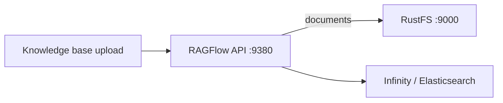

このガイドは、オープンソースの RAG エンジン [RAGFlow](https://github.com/infiniflow/ragflow) を、オブジェクトストレージとして **RustFS** に接続します。RAGFlow は MinIO 互換のクライアント設定を通じて、アップロードされたすべてのドキュメントと解析成果物を S3 互換ストレージに保存します。その設定を RustFS に向け、スタックを起動し、ナレッジベースにドキュメントをアップロードして、バケット内のオブジェクトを確認します。このワークフローは `infiniflow/ragflow:v1.0.0-rc3` と Infinity ドキュメントエンジンで検証しました。

Docker Compose が必要です。このデプロイはローカルでの結合テスト用であり、本番環境向けではありません。

## アーキテクチャ



テナントごとにテナント ID を名前とするバケットが割り当てられ、アップロードされた各ファイルはそのバケット内のオブジェクトになります。解析はソース文書の隣に成果物を書き込みます。

## 1. スタックを RustFS 向けに設定する

RAGFlow をクローンし、`docker/.env` を編集します。Infinity ドキュメントエンジンを選び、ストレージクライアントを RustFS に向けます：

```ini title="docker/.env"
DOC_ENGINE=infinity
MINIO_HOST=<your-rustfs-endpoint>
MINIO_USER=<your-access-key>
MINIO_PASSWORD=<your-secret-key>
```

`docker/service_conf.yaml.template` の `minio:` セクションはこれらの変数から生成されるため、同じフィールドで任意の S3 互換エンドポイントを扱えます。RAGFlow は最初のアップロード時にテナントごとのバケットを自動作成するため、事前作成は不要です。

:::note[RustFS コンテナにネットワークエイリアスを付ける]

Compose スタックは独自のブリッジネットワークで動き、Docker はブリッジ同士を分離するため、RustFS コンテナの `172.17.0.x` アドレスはスタックから到達できません。RustFS をエイリアス付きで Compose ネットワークに接続し、そのエイリアスを `MINIO_HOST` に使ってください：

```bash
docker network connect --alias rustfs ragflow_ragflow <rustfs-container>
```

レジストリの都合で内蔵 MinIO イメージ（quay.io から）を取得できない場合は置き換えてください。`MINIO_HOST` が別の場所を指していれば、スタックはそれにアクセスしません。

:::

## 2. スタックを起動する

```bash
cd ragflow/docker
docker compose -p ragflow up -d
```

API の起動を待ち、サーバーが読み込んだストレージ設定を確認します：

```bash
docker logs ragflow-cpu 2>&1 | grep "minio:"
```

```text
minio: {'user': '...', 'password': '...', 'host': 'rustfs:9000', 'bucket': '', 'prefix_path': ''}
```

`bucket` が空なのは想定通りです。RAGFlow は最初のアップロード時にテナントごとのバケットを作成します。

## 3. ナレッジベースにドキュメントをアップロードする

ユーザーと API キーを作成し（`https://localhost:443` の Web UI またはユーザー API 経由）、HTTP API を使います：

```bash
curl -s -X POST http://localhost:9380/api/v1/datasets \
  -H "Authorization: Bearer <your-api-key>" -H "Content-Type: application/json" \
  -d '{"name":"rustfs-kb"}'

curl -s -X POST "http://localhost:9380/api/v1/datasets/<dataset-id>/documents" \
  -H "Authorization: Bearer <your-api-key>" \
  -F "file=@rustfs-overview.txt"
```

```json
{"code":0,"data":[{"chunk_method":"naive","location":"rustfs-overview.txt","name":"rustfs-overview.txt","run":"UNSTART"}]}
```

オブジェクトが RustFS に着いたことを確認します。テナントバケットはテナント ID を名前とします：

```bash
aws s3 ls s3://<tenant-id>/ --recursive \
  --endpoint-url http://<your-rustfs-endpoint>:9000
```

```text
2026-11-01 16:02:41        204 rg-doc.txt
```

オブジェクトを読み戻し、アップロードしたファイルと比較します：

```bash
aws s3 cp s3://<tenant-id>/rg-doc.txt - \
  --endpoint-url http://<your-rustfs-endpoint>:9000
```


## 4. 解析と検索

ドキュメント解析（`{"run":"parse"}` を付けた `PUT /api/v1/datasets/{id}/documents/{doc_id}`）は、RustFS に保存されたオブジェクトを消費し、チャンクの成果物をその隣に書き込みます。解析にはさらに RAGFlow で設定した embedding モデルが必要です。このステップはモデル構成に依存するもので、ストレージには依存しません。

## 5. 停止またはリセット

バケットのオブジェクトを残したままスタックを停止するには：

```bash
docker compose -p ragflow stop
```

テナントのデータを削除するには：

```bash
aws s3 rm s3://<tenant-id> --recursive \
  --endpoint-url http://<your-rustfs-endpoint>:9000
```

## トラブルシューティング

### アップロードは成功するが RustFS に何も現れない

サーバーがまだ内蔵 MinIO と通信しています。起動ログの `minio:` 行を確認し、ホストが RustFS のエイリアスでなければ、`.env` の変更がコンテナに届いていません。`docker compose -p ragflow up -d --force-recreate ragflow-cpu` で再作成してください。

### 起動ログに `tcp connect error: Connection timed out`

RustFS コンテナのアドレスが Compose ネットワークから到達可能ではありません。手順 1 のとおり RustFS をエイリアス付きで Compose ネットワークに接続し、`MINIO_HOST` にはエイリアスを指定してください。

### `/api/v1` で `Authentication error: API key is invalid!`

`/api/v1` の SDK ルートは RAGFlow の API キー（Web UI で作成）を受け付け、ログインのアクセストークンは受け付けません。`/v1/*` ルートはログインセッションを使います。

### 登録やログインでパスワードエラー

RAGFlow は API に到達する前に、同梱の RSA 公開鍵でパスワードを暗号化することを求めます。Web UI はこれを自動で行います。クライアント側の暗号化を再現しない限り、アカウント作成には UI を使用してください。

## 次のステップ

- 大規模な取り込みの前に [S3 互換性についての注意](/administration/protocols/s3) を確認してください。
- [アクセスキー管理](/security-compliance/iam/access-token) で本番用の専用認証情報を作成してください。
- [RAGFlow ドキュメント](https://ragflow.io/docs/dev/) に従い、同じバケットでチャンクテンプレート・embedding モデル・エージェントワークフローを活用してください。
