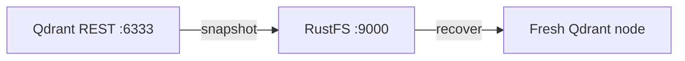
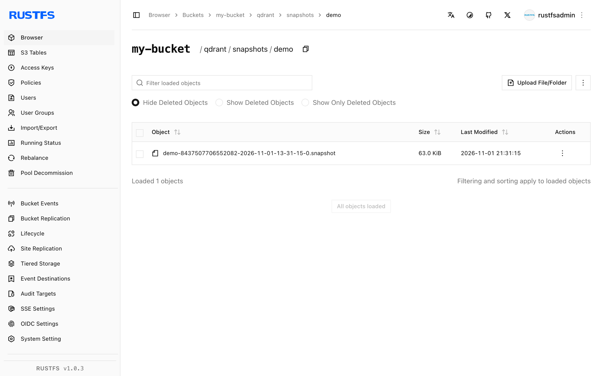

このガイドは、AI 検索と RAG 向けのオープンソース ベクトルデータベース [Qdrant](https://github.com/qdrant/qdrant) を、スナップショットの保存先として **RustFS** に接続します。S3 バックエンドのスナップショットを有効化し、ベクトル入りコレクションを作成し、スナップショットをバケットへアップロードした後、まっさらなノードにリストアします。このワークフローは `qdrant/qdrant:v1.20.0` がパススタイル addressing で RustFS バケットへスナップショットを書き込む形で検証しました。

Docker が必要です。このデプロイはローカルでの結合テスト用であり、本番環境向けではありません。

## アーキテクチャ



`snapshots_storage: s3` を有効にすると、各コレクションスナップショットは `<prefix>/snapshots/<collection>/` の下にバケットへアップロードされます。同じバケットを指す新しいノードは、ローカルファイルなしで任意のコレクションを再構築できます。

## 1. Qdrant を RustFS に向ける

スナップショットストレージは環境変数で設定します。`QDRANT__` プレフィックスが設定ツリーに対応し、`S3_CONFIG__ENDPOINT_URL` が MinIO 類のストレージ向けカスタムエンドポイントのフィールドです。バケットは事前に作成してください。プレフィックスは空でも構いません。

```bash
docker run -d --name qdrant -p 6333:6333 \
  -e QDRANT__STORAGE__SNAPSHOTS_CONFIG__SNAPSHOTS_STORAGE=s3 \
  -e QDRANT__STORAGE__SNAPSHOTS_CONFIG__S3_CONFIG__BUCKET=my-bucket \
  -e QDRANT__STORAGE__SNAPSHOTS_CONFIG__S3_CONFIG__PREFIX=qdrant \
  -e QDRANT__STORAGE__SNAPSHOTS_CONFIG__S3_CONFIG__REGION=us-east-1 \
  -e QDRANT__STORAGE__SNAPSHOTS_CONFIG__S3_CONFIG__ACCESS_KEY=<your-access-key> \
  -e QDRANT__STORAGE__SNAPSHOTS_CONFIG__S3_CONFIG__SECRET_KEY=<your-secret-key> \
  -e QDRANT__STORAGE__SNAPSHOTS_CONFIG__S3_CONFIG__ENDPOINT_URL=http://<your-rustfs-endpoint>:9000 \
  qdrant/qdrant:v1.20.0
```

:::note[QDRANT__STORAGE__SNAPSHOTS_CONFIG のパスを使う]

リリース済みの Qdrant では設定は `storage.snapshots_config` の下にあり（`storage.snapshots` ではない）、S3 セクションのエンドポイントキーは `endpoint_url` です。古いキー名の `custom_config.yaml` をマウントしても黙って無視され、スナップショットはローカルの `./snapshots` に書き込まれ続けます。切り替わりの確認は、スナップショット作成後にローカルディレクトリが空のままであることで行います。

:::

## 2. コレクションを作成してスナップショットを取る

コレクションを作成し、ポイントを挿入し、スナップショットを要求します：

```bash
curl -s -X PUT http://localhost:6333/collections/demo \
  -H "Content-Type: application/json" \
  -d '{"vectors":{"size":4,"distance":"Dot"}}'

curl -s -X PUT "http://localhost:6333/collections/demo/points?wait=true" \
  -H "Content-Type: application/json" \
  -d '{"points":[{"id":1,"vector":[0.1,0.2,0.3,0.4],"payload":{"city":"Berlin"}},{"id":2,"vector":[0.9,0.8,0.7,0.6],"payload":{"city":"Tokyo"}}]}'

curl -s -X POST http://localhost:6333/collections/demo/snapshots
```

```json
{"result":{"name":"demo-8437507706552082-2026-11-01-13-31-15-0.snapshot","size":64512},"status":"ok"}
```

スナップショットのオブジェクトが RustFS に着いたことを確認します。接続プレースホルダーをすべて置き換えてください：

```bash
aws s3 ls s3://my-bucket/qdrant/ --recursive \
  --endpoint-url http://<your-rustfs-endpoint>:9000
```

```text
2026-11-01 13:31:15  64512 qdrant/snapshots/demo/demo-8437507706552082-2026-11-01-13-31-15-0.snapshot
```



## 3. まっさらなノードでリストアする

スナップショットは同名のコレクションへリストアされます。同じバケットを指すようにローカルノードを初期化（または 2 台目を起動）し、RustFS からスナップショットをダウンロードしてリカバリ API に渡します：

```bash
aws s3 cp "s3://my-bucket/qdrant/snapshots/demo/demo-8437507706552082-2026-11-01-13-31-15-0.snapshot" . \
  --endpoint-url http://<your-rustfs-endpoint>:9000

curl -s -X POST "http://localhost:6333/collections/demo/snapshots/upload?priority=snapshot" \
  -F "snapshot=@demo-8437507706552082-2026-11-01-13-31-15-0.snapshot"
```

リストアされたデータを確認します：

```bash
curl -s -X POST http://localhost:6333/collections/demo/points/scroll \
  -H "Content-Type: application/json" -d '{"limit":2,"with_payload":true}'
```

```json
{"result":{"points":[{"id":1,"payload":{"city":"Berlin"}},{"id":2,"payload":{"city":"Tokyo"}}]},"status":"ok"}
```

ベクトルも payload も、RustFS が保存したスナップショットから完全に戻ってきます。

## 4. 停止またはリセット

バケットのオブジェクトを残したままデモを解体するには：

```bash
docker rm -f qdrant
```

保存済みスナップショットを削除するには：

```bash
aws s3 rm s3://my-bucket/qdrant --recursive \
  --endpoint-url http://<your-rustfs-endpoint>:9000
```

## トラブルシューティング

### スナップショットがコンテナの `/qdrant/snapshots` に現れ続ける

ストレージの切り替えが適用されていません。変数のパスが違うか、古い設定ファイルが上書きしています。手順 1 の `QDRANT__STORAGE__SNAPSHOTS_CONFIG__*` 変数を正確に使ってコンテナを再起動し、その後ローカルのスナップショットディレクトリが空のままであることを確認してください。

### `Wrong input: Snapshot is not compatible with existing collection`

復元先のコレクションが別スキーマで既に存在します。リストア前に空または古いコレクションを削除してください。アップロード API がスナップショットからコレクションを作成します。

### スナップショット作成後にバケットが空

バケット名かエンドポイントが誤りです。エンドポイントにはスキーマが必須で、バケットは存在している必要があります。オブジェクトキーは `<prefix>/snapshots/<collection>/<name>.snapshot` なので、再帰的に一覧してください。

## 次のステップ

- スナップショットバックアップを計画する前に [S3 互換性についての注意](/administration/protocols/s3) を確認してください。
- [アクセスキー管理](/security-compliance/iam/access-token) で本番用の専用認証情報を作成してください。
- [Qdrant スナップショットのドキュメント](https://qdrant.tech/documentation/snapshots/) に従い、同じバケットでフルストレージスナップショット・シャード単位のスナップショット・バージョン互換性を活用してください。
