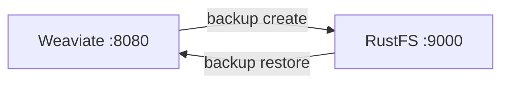

このガイドは、AI 検索と RAG 向けのオープンソース ベクトルデータベース [Weaviate](https://github.com/weaviate/weaviate) を、`backup-s3` モジュール経由で **RustFS** に接続します。モジュールを有効化し、ベクトル入りコレクションを作成し、バケット内にバックアップを作成した後、リストアします。このワークフローは `semitechnologies/weaviate:1.31.0` が RustFS バケットへバックアップする形で検証しました。

Docker が必要です。このデプロイはローカルでの結合テスト用であり、本番環境向けではありません。

## アーキテクチャ



バックアップは `backup_config.json`、クラスごとの `backup.json`、データチャンクをバケットの `<backup-id>/` プレフィックスへ書き込みます。リストアは同じコレクション名で読み戻します。

## 1. backup-s3 モジュールを有効にする

モジュールと S3 設定付きで Weaviate を起動します。認証情報は標準の AWS 変数で渡します。Weaviate 1.31 のモジュールは `BACKUP_S3_ACCESS_KEY_ID` ではなく `AWS_ACCESS_KEY_ID` と `AWS_SECRET_ACCESS_KEY` を読みます：

```bash
docker run -d --name weaviate -p 8080:8080 \
  -e QUERY_DEFAULTS_LIMIT=20 \
  -e AUTHENTICATION_ANONYMOUS_ACCESS_ENABLED=true \
  -e PERSISTENCE_DATA_PATH=/var/lib/weaviate \
  -e ENABLE_MODULES=backup-s3 \
  -e BACKUP_S3_BUCKET=my-bucket \
  -e AWS_REGION=us-east-1 \
  -e AWS_ACCESS_KEY_ID=<your-access-key> \
  -e AWS_SECRET_ACCESS_KEY=<your-secret-key> \
  -e BACKUP_S3_ENDPOINT=<your-rustfs-endpoint>:9000 \
  -e BACKUP_S3_USE_SSL=false \
  -e CLUSTER_HOSTNAME=weaviate-demo \
  semitechnologies/weaviate:1.31.0
```

:::note[エンドポイント形式と認証情報]

`BACKUP_S3_ENDPOINT` はスキーマなしの `host:port` を受け付けます。モジュールの背後にある AWS SDK Go v1 クライアントは `http://...` 形式を `Endpoint url cannot have fully qualified paths` で拒否します。TLS は `BACKUP_S3_USE_SSL=false` で制御し、リクエストはパススタイルです。`AWS_ACCESS_KEY_ID` の代わりに `BACKUP_S3_ACCESS_KEY_ID` を渡すとクライアントは匿名になり、すべてのバックアップ呼び出しが `Access Denied` で失敗します。

:::

モジュールが有効になったことを確認します：

```bash
curl -s http://localhost:8080/v1/meta | grep -o "backup-s3"
```

## 2. コレクションを作成してバックアップする

Weaviate 1.31 では `POST /v1/schema` でスキーマを作成します。オブジェクトを 2 つ挿入してからバックアップを開始します：

```bash
curl -s -X POST http://localhost:8080/v1/schema \
  -H "Content-Type: application/json" \
  -d '{"class":"Doc","vectorizer":"none","properties":[{"name":"title","dataType":["text"]}]}'

curl -s -X POST http://localhost:8080/v1/objects -H "Content-Type: application/json" \
  -d '{"class":"Doc","properties":{"title":"RustFS vector backup"},"vector":[0.11,0.22,0.33,0.44]}'

curl -s -X POST http://localhost:8080/v1/backups/s3 -H "Content-Type: application/json" \
  -d '{"id":"rustfs-demo"}'
```

```json
{"backend":"s3","classes":["Doc"],"id":"rustfs-demo","path":"s3://my-bucket/rustfs-demo","status":"STARTED"}
```

`SUCCESS` を待ち、RustFS 内のオブジェクトを確認します。接続プレースホルダーをすべて置き換えてください：

```bash
curl -s http://localhost:8080/v1/backups/s3/rustfs-demo
aws s3 ls s3://my-bucket/rustfs-demo/ --recursive \
  --endpoint-url http://<your-rustfs-endpoint>:9000
```

```text
2026-11-01 13:46:10        304 rustfs-demo/backup_config.json
2026-11-01 13:46:08       1406 rustfs-demo/weaviate-demo/Doc/chunk-1
2026-11-01 13:46:08      27666 rustfs-demo/weaviate-demo/backup.json
```


## 3. リストアする

バックアップを Weaviate へリストアします（クリーンな復元のため、先にライブのクラスを削除します）：

```bash
curl -s -X POST http://localhost:8080/v1/backups/s3/rustfs-demo/restore \
  -H "Content-Type: application/json" -d '{}'
```

リストアされたデータをクエリします：

```bash
curl -s -X POST http://localhost:8080/v1/graphql -H "Content-Type: application/json" \
  -d '{"query":"{Get{Doc(limit:2){title}}}"}'
```

```json
{"data":{"Get":{"Doc":[{"title":"RustFS vector backup"},{"title":"Weaviate on object storage"}]}}}
```

## 4. 停止またはリセット

バケットのオブジェクトを残したままデモを解体するには：

```bash
docker rm -f weaviate
```

保存済みバックアップを削除するには：

```bash
aws s3 rm s3://my-bucket/rustfs-demo --recursive \
  --endpoint-url http://<your-rustfs-endpoint>:9000
```

## トラブルシューティング

### 起動時に `Endpoint url cannot have fully qualified paths`

`BACKUP_S3_ENDPOINT` にスキーマが含まれています。素の `host:port` 形式にして `BACKUP_S3_USE_SSL=false` を設定してください。

### バックアップ作成時に `Access Denied`

モジュールが認証情報を取得できていません。Weaviate 1.31 の S3 クライアントは環境変数 `AWS_ACCESS_KEY_ID` と `AWS_SECRET_ACCESS_KEY`（または `AWS_ACCESS_KEY`/`AWS_SECRET_KEY`）を読みます。`BACKUP_S3_ACCESS_KEY_ID` だけでは不十分です。

### エラーに `s3://my-bucket/s3Path/...` が現れる

このバージョンで `BACKUP_S3_PATH` はバケットのサブプレフィックスであり、パススタイルのスイッチではありません。`s3Path` を設定しないでください。Weaviate の S3 クライアントはカスタムエンドポイントに対して自動的にパススタイルを使います。

### `check if backup ... exists` が予期しないエラーで失敗する

コンテナから RustFS に到達できていません。エンドポイントのホストが名前解決でき、バケットが存在することを確認してください。

## 次のステップ

- バックアップの自動化の前に [S3 互換性についての注意](/administration/protocols/s3) を確認してください。
- [アクセスキー管理](/security-compliance/iam/access-token) で本番用の専用認証情報を作成してください。
- [Weaviate バックアップのドキュメント](https://docs.weaviate.io/deploy/configuration/backups) に従い、同じバケットでリストアフィルタ・ロールベースのバックアップ・ファイルシステム代替を活用してください。
