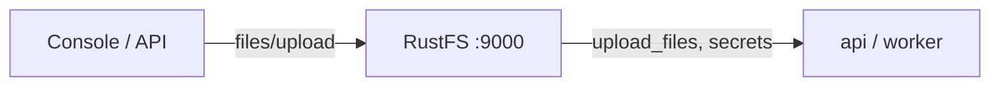
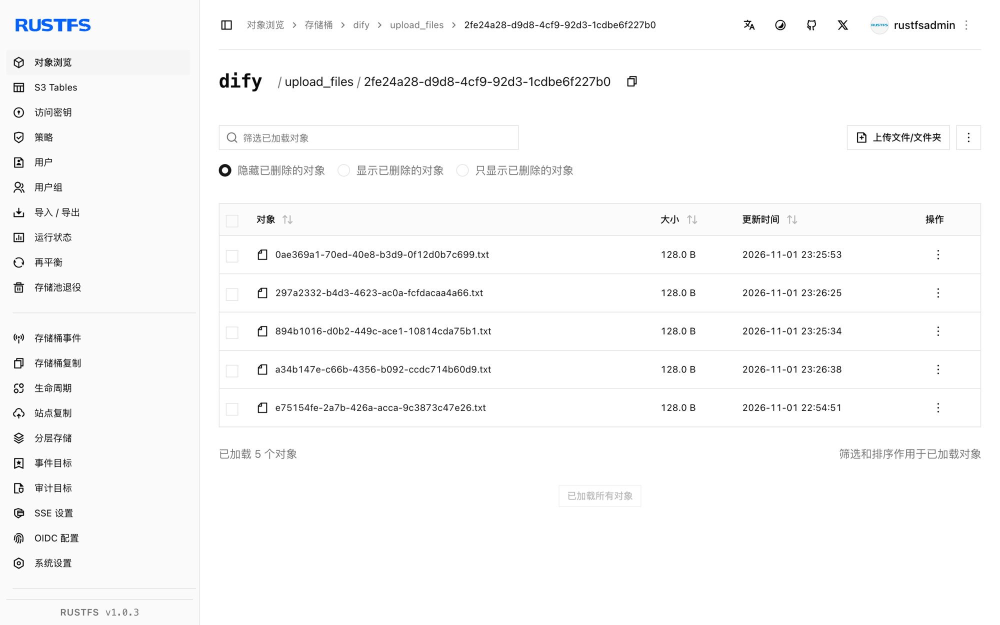

本指南将开源 LLM 应用平台 [Dify](https://github.com/langgenius/dify) 通过其 OpenDAL 存储后端连接到 **RustFS**。你将把文件存储从本地磁盘切换到 RustFS 桶，启动栈，向知识库上传文档，并在桶中确认对象。整个流程使用 Dify `1.18.0`（Docker Compose）验证通过。

你需要 Docker Compose。本部署用于本地集成测试，不适用于生产环境。

## 架构



Dify 通过配置的存储后端持久化上传文档、知识库文件和引导密钥（`.dify_secret_key`、工作区密钥）。后端是桶时，这些都不再落在容器磁盘上。

## 1. 为 RustFS 配置存储

在 `docker/.env`（从 `.env.example` 复制）里把 OpenDAL 切到 S3 scheme：

```ini title="docker/.env"
STORAGE_TYPE=opendal
OPENDAL_SCHEME=s3
OPENDAL_S3_ENDPOINT=http://<your-rustfs-endpoint>:9000
OPENDAL_S3_BUCKET=dify
OPENDAL_S3_ACCESS_KEY_ID=<your-access-key>
OPENDAL_S3_SECRET_ACCESS_KEY=<your-secret-key>
OPENDAL_S3_REGION=us-east-1
OPENDAL_S3_ENABLE_PATH_STYLE=true
OPENDAL_S3_ROOT=/
```

启动栈前先建桶：

```bash
aws s3 mb s3://dify --endpoint-url http://<your-rustfs-endpoint>:9000
```

:::note[把 RustFS 接入 Compose 网络]

Compose 栈在自己的 bridge 网络里，而 Docker 会隔离不同 bridge——`http://172.17.0.2:9000` 这类端点在 `api` 容器里会连接超时。把 RustFS 容器以别名接入 Compose 网络，端点主机用别名：

```bash
docker network connect --alias rustfs <compose-network> <rustfs-container>
```

修改 `.env` 后要重建整个栈——`docker compose restart` 不会重读环境变量。

:::

## 2. 启动栈并初始化

```bash
cd dify/docker
docker compose up -d
```

等 `api` 健康检查通过，在 Web UI（`http://localhost:80`）创建管理员账号。Dify 会立刻把引导状态写进桶：

```bash
aws s3 ls s3://dify/ --recursive \
  --endpoint-url http://<your-rustfs-endpoint>:9000
```

```text
2026-11-01 14:31:00         65 .dify_secret_key
2026-11-01 14:33:06       1674 privkeys/<tenant-id>/private.pem
```

密钥与工作区私钥现在都在 RustFS——容器里没有值得保留的状态。

## 3. 上传知识库文档

在 UI 里创建知识库，然后上传文档。上传会落到桶的 `upload_files/<tenant-id>/` 下：

```bash
aws s3 ls s3://dify/upload_files/ --recursive \
  --endpoint-url http://<your-rustfs-endpoint>:9000
```

```text
2026-11-01 15:25:53        128 upload_files/<tenant-id>/0ae369a1-70ed-40e8-b3d9-0f12d0b7c699.txt
```

上传完成的瞬间对象即出现——索引流程直接针对桶内副本运行。



## 4. 停止或重置

保留桶内对象并拆除栈：

```bash
docker compose down
```

删除 Dify 数据：

```bash
aws s3 rm s3://dify --recursive \
  --endpoint-url http://<your-rustfs-endpoint>:9000
```

:::warning[重置时记得清 bind mount]

Dify 的 Compose 文件把数据库和存储 bind-mount 在 `docker/volumes/` 下。`docker compose down -v` 不会删除 bind mount——需要干净环境时显式删除 `docker/volumes/`，否则旧管理员账号和加密状态会残留。

:::

## 故障排查

### 启动日志对桶报 `tcp connect error: Connection timed out`

栈到不了 RustFS 地址——Docker bridge 之间的网络隔离。按第 1 步把 RustFS 以别名接入 Compose 网络。

### 登录报 `Invalid encrypted data`

管理员密码字段由前端做 Base64 编码；直接给 console API 发明文会失败。账号与密码操作请走 Web UI，或按前端方式编码字段。

### 创建文档报 `Default model not found for text-embedding`

`high-quality` 索引模式需要在 Dify 里配置 embedding 模型供应商。纯存储测试用 `economy` 索引，或先配置模型供应商。

### 上传仍落在本地磁盘

`api` 和 `worker` 容器还是 `.env` 修改前的旧实例。用 `docker compose up -d --force-recreate` 重建整个栈，让每个服务都读到新存储配置。

## 下一步

- 在扩展大型知识库前，先阅读 [S3 兼容性说明](/administration/protocols/s3)。
- 使用[访问密钥管理](/security-compliance/iam/access-token)创建专用的生产凭证。
- 按照 [Dify 环境变量参考](https://docs.dify.ai/en/self-host/deploy/configuration/environments)了解插件守护进程独立的 S3 设置与同一桶上的分段上传调优。
