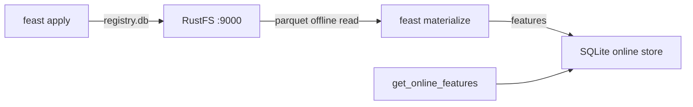
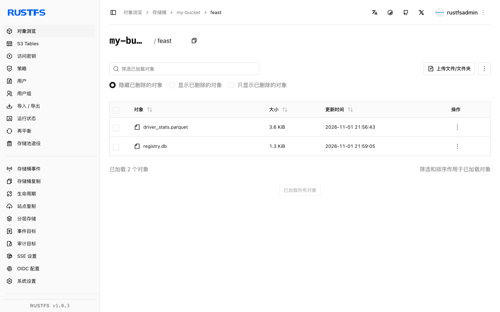

本指南将开源特征存储 [Feast](https://github.com/feast-dev/feast) 连接到 **RustFS**，同时承担两个存储角色：特征注册表（`registry.db`）放在桶里，离线特征源是同一桶里的 Parquet 文件。你将 apply 一个特征仓库、把特征从 RustFS 物化进在线存储，再读回。整个流程使用 Feast `0.67.0` 验证通过。

你需要 Python 3.10+。本部署用于本地集成测试，不适用于生产环境。

## 架构



注册表存储通过 boto3 读写桶里的 `registry.db`，文件离线存储通过 s3fs 读 Parquet——两者都支持自定义端点，因此整个特征历史层都在桶上，在线存储保持本地。

## 1. 安装带 S3 支持的 Feast

基础包不含 S3 客户端，需要显式安装：

```bash
python3 -m venv .venv
./.venv/bin/pip install feast boto3 s3fs
```

上传离线特征数据，替换全部连接占位符：

```bash
aws s3 cp driver_stats.parquet s3://my-bucket/feast/driver_stats.parquet \
  --endpoint-url http://<your-rustfs-endpoint>:9000
```

## 2. 配置仓库

创建仓库文件。注册表是普通的 `s3://` URI，端点覆盖来自 `FEAST_S3_ENDPOINT_URL` 环境变量；数据源自带 `s3_endpoint_override`：

```yaml title="feature_store.yaml"
project: rustfs_demo
provider: local
registry: s3://my-bucket/feast/registry.db
offline_store:
  type: file
entity_key_serialization_version: 3
```

```python title="features.py"
from datetime import timedelta
from feast import Entity, FeatureView, Field, FileSource
from feast.types import Float32, Int64

driver = Entity(name="driver", join_keys=["driver_id"])
source = FileSource(
    name="driver_stats_source",
    path="s3://my-bucket/feast/driver_stats.parquet",
    timestamp_field="event_timestamp",
    s3_endpoint_override="http://<your-rustfs-endpoint>:9000",
)
driver_stats = FeatureView(
    name="driver_stats",
    entities=[driver],
    ttl=timedelta(days=1),
    schema=[Field(name="conv_rate", dtype=Float32), Field(name="avg_daily_trips", dtype=Int64)],
    source=source,
)
```

为注册表客户端导出端点和凭证：

```bash
export FEAST_S3_ENDPOINT_URL=http://<your-rustfs-endpoint>:9000
export AWS_ACCESS_KEY_ID=<your-access-key>
export AWS_SECRET_ACCESS_KEY=<your-secret-key>
export AWS_DEFAULT_REGION=us-east-1
```

## 3. Apply 仓库并物化

`feast apply` 把 `registry.db` 写进桶；`materialize-incremental` 把 RustFS 里的 Parquet 特征读进本地在线存储：

```bash
./.venv/bin/feast apply
./.venv/bin/feast materialize-incremental 2026-11-02T00:00:00Z
```

```text
Created entity driver
Created feature view driver_stats
...
driver_stats from 2026-10-31 ... to 2026-11-02 00:00:00+00:00:
```

确认注册表对象已在 RustFS：

```bash
aws s3 ls s3://my-bucket/feast/ \
  --endpoint-url http://<your-rustfs-endpoint>:9000
```

```text
2026-11-01 13:57:58       1322 registry.db
2026-11-01 13:56:43       3680 driver_stats.parquet
```



## 4. 读回特征

```bash
./.venv/bin/python - <<'PY'
from feast import FeatureStore
store = FeatureStore(repo_path=".")
res = store.get_online_features(
    features=["driver_stats:conv_rate", "driver_stats:avg_daily_trips"],
    entity_rows=[{"driver_id": 101}],
).to_dict()
print("conv_rate:", res["conv_rate"][0])
print("avg_daily_trips:", res["avg_daily_trips"][0])
PY
```

```text
conv_rate: 0.699999988079071
avg_daily_trips: 130
```

被服务的特征来自 RustFS 存储的 Parquet 文件物化而来。

## 5. 停止或重置

删除仓库对象：

```bash
aws s3 rm s3://my-bucket/feast --recursive \
  --endpoint-url http://<your-rustfs-endpoint>:9000
```

## 故障排查

### `Could not import module 'feast.infra.registry.s3'`

S3 注册表存储需要 `boto3`，基础 Feast 包不安装它。按第 1 步 `pip install boto3`（离线存储还要 `s3fs`）。

### 物化时报 `Install s3fs to access S3`

文件离线存储通过 `s3fs` 读 Parquet。与 `boto3` 一起安装。

### 注册表 S3 存储忽略端点

注册表只从 `FEAST_S3_ENDPOINT_URL` 环境变量读端点——普通的 `AWS_ENDPOINT_URL` 在这里无效。`FileSource` 用自己的 `s3_endpoint_override`；两者都要设置。

### 出现实体键序列化的弃用警告

在 `feature_store.yaml` 里设 `entity_key_serialization_version: 3`——低于 3 的版本对新在线存储已不接受。

## 下一步

- 在把生产注册表指向桶之前，先阅读 [S3 兼容性说明](/administration/protocols/s3)。
- 使用[访问密钥管理](/security-compliance/iam/access-token)创建专用的生产凭证。
- 按照 [Feast 文档](https://docs.feast.dev/)在同一个桶上使用流式源、特征服务与注册表替代方案。
