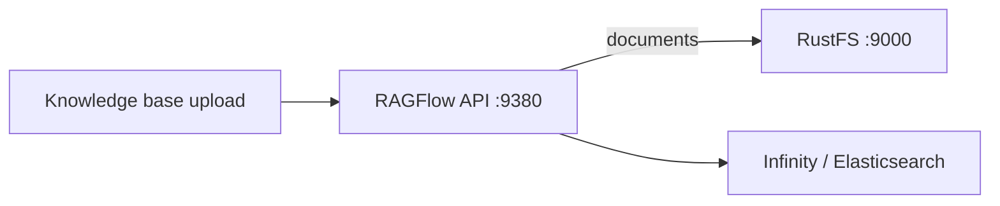
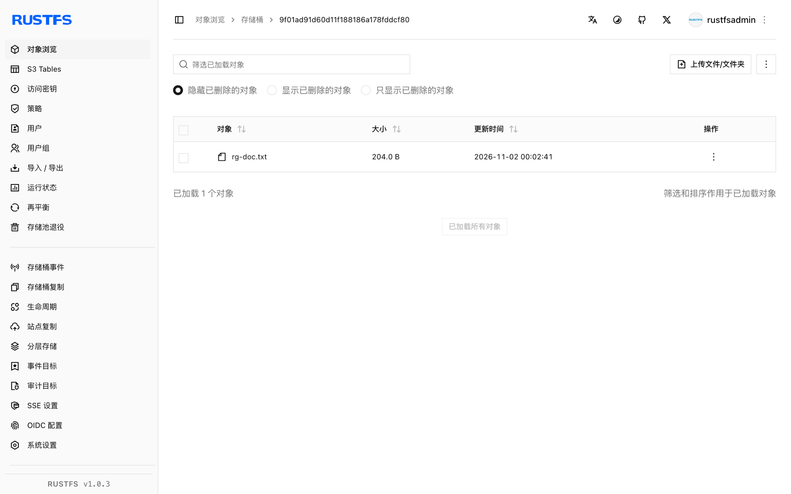

本指南将开源 RAG 引擎 [RAGFlow](https://github.com/infiniflow/ragflow) 连接到 **RustFS** 作为其对象存储。RAGFlow 通过 MinIO 兼容的客户端配置把每个上传文档和解析产物存进 S3 兼容存储。你将把该配置指向 RustFS，启动栈，向知识库上传文档，并在桶中确认对象。整个流程使用 `infiniflow/ragflow:v1.0.0-rc3`（Infinity 文档引擎）验证通过。

你需要 Docker Compose。本部署用于本地集成测试，不适用于生产环境。

## 架构



每个租户获得一个以其租户 ID 命名的桶，每个上传文件都是该桶下的一个对象。解析会在源文档旁写入更多产物。

## 1. 配置栈指向 RustFS

克隆 RAGFlow 并编辑 `docker/.env`。选择 Infinity 文档引擎，并把存储客户端指向 RustFS：

```ini title="docker/.env"
DOC_ENGINE=infinity
MINIO_HOST=<your-rustfs-endpoint>
MINIO_USER=<your-access-key>
MINIO_PASSWORD=<your-secret-key>
```

`docker/service_conf.yaml.template` 的 `minio:` 段由这些变量渲染，所以同一组字段驱动任意 S3 兼容端点。RAGFlow 会在首次上传时自动为每个租户创建桶——无需预建。

:::note[给 RustFS 容器加网络别名]

Compose 栈在自己的 bridge 网络里，而 Docker 会隔离不同 bridge，因此 RustFS 容器的 `172.17.0.x` 地址对栈不可达。把 RustFS 以别名接入 Compose 网络，并把别名用作 `MINIO_HOST`：

```bash
docker network connect --alias rustfs ragflow_ragflow <rustfs-container>
```

如果你的镜像仓库拉不到内置 MinIO 镜像（来自 quay.io），可以替换它——`MINIO_HOST` 指向别处时栈根本不会访问它。

:::

## 2. 启动栈

```bash
cd ragflow/docker
docker compose -p ragflow up -d
```

等 API 起来后，确认服务加载的存储配置：

```bash
docker logs ragflow-cpu 2>&1 | grep "minio:"
```

```text
minio: {'user': '...', 'password': '...', 'host': 'rustfs:9000', 'bucket': '', 'prefix_path': ''}
```

`bucket` 为空是预期行为：RAGFlow 会在首次上传时为每个租户建桶。

## 3. 向知识库上传文档

创建用户和 API key（通过 `https://localhost:443` 的 Web UI，或用户 API），然后走 HTTP API：

```bash
curl -s -X POST http://localhost:9380/api/v1/datasets \
  -H "Authorization: Bearer <your-api-key>" -H "Content-Type: application/json" \
  -d '{"name":"rustfs-kb"}'

curl -s -X POST "http://localhost:9380/api/v1/datasets/<dataset-id>/documents" \
  -H "Authorization: Bearer <your-api-key>" \
  -F "file=@rustfs-overview.txt"
```

```json
{"code":0,"data":[{"chunk_method":"naive","location":"rustfs-overview.txt","name":"rustfs-overview.txt","run":"UNSTART"}]}
```

确认对象已落 RustFS——租户桶以租户 ID 命名：

```bash
aws s3 ls s3://<tenant-id>/ --recursive \
  --endpoint-url http://<your-rustfs-endpoint>:9000
```

```text
2026-11-01 16:02:41        204 rg-doc.txt
```

读回对象并与上传文件比对：

```bash
aws s3 cp s3://<tenant-id>/rg-doc.txt - \
  --endpoint-url http://<your-rustfs-endpoint>:9000
```



## 4. 解析与检索

文档解析（`PUT /api/v1/datasets/{id}/documents/{doc_id}` 带 `{"run":"parse"}`）会从 RustFS 消费已存储的对象，并把分块产物写到旁边。解析还需要在 RAGFlow 中配置 embedding 模型——该步骤取决于你的模型配置，与存储无关。

## 5. 停止或重置

保留桶内对象并拆除栈：

```bash
docker compose -p ragflow stop
```

删除租户数据：

```bash
aws s3 rm s3://<tenant-id> --recursive \
  --endpoint-url http://<your-rustfs-endpoint>:9000
```

## 故障排查

### 上传成功但 RustFS 里没有对象

服务还在连内置 MinIO。看启动日志里的 `minio:` 行——如果 host 不是你的 RustFS 别名，说明 `.env` 的修改没进容器；用 `docker compose -p ragflow up -d --force-recreate ragflow-cpu` 重建。

### 启动日志出现 `tcp connect error: Connection timed out`

RustFS 容器地址对 Compose 网络不可达。按第 1 步把 RustFS 以别名接入 Compose 网络，并把 `MINIO_HOST` 设为别名。

### `/api/v1` 报 `Authentication error: API key is invalid!`

`/api/v1` SDK 路由接受 RAGFlow API key（Web UI 里创建），不是登录 access token。`/v1/*` 路由走登录会话。

### 注册或登录报密码错误

RAGFlow 要求密码先经其内置 RSA 公钥加密再到达 API——Web UI 会自动处理。除非复现客户端加密，否则请用 UI 创建账号。

## 下一步

- 在大规模接入前，先阅读 [S3 兼容性说明](/administration/protocols/s3)。
- 使用[访问密钥管理](/security-compliance/iam/access-token)创建专用的生产凭证。
- 按照 [RAGFlow 文档](https://ragflow.io/docs/dev/)在同一个桶上使用分块模板、embedding 模型与 Agent 工作流。
