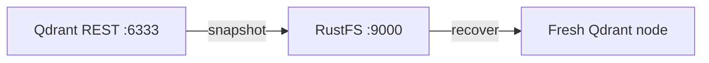
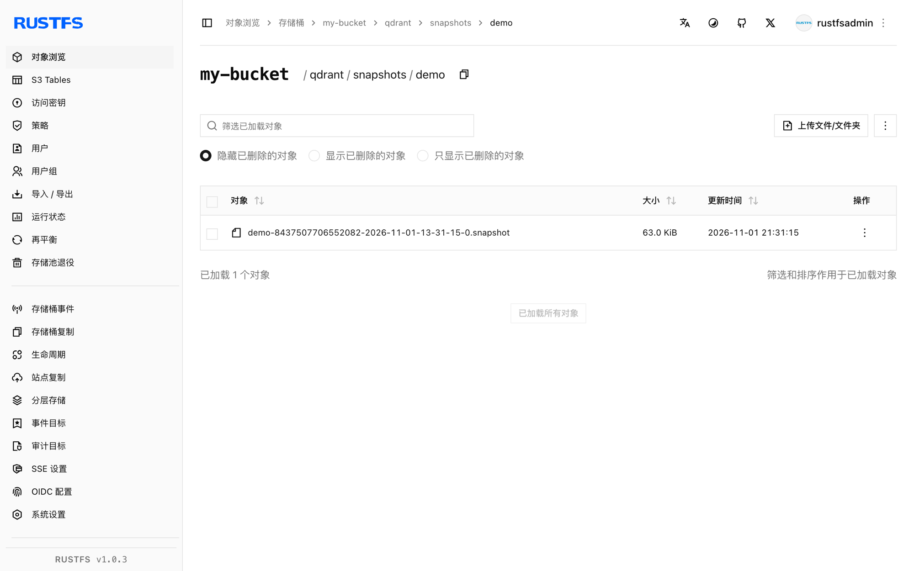

本指南将开源向量数据库 [Qdrant](https://github.com/qdrant/qdrant)（面向 AI 搜索与 RAG）连接到 **RustFS** 作为其快照存储。你将启用 S3 快照存储，创建集合并插入向量，把快照上传进桶，再在全新节点上恢复它。整个流程使用 `qdrant/qdrant:v1.20.0` 以路径样式寻址向 RustFS 桶写入快照验证通过。

你需要 Docker。本部署用于本地集成测试，不适用于生产环境。

## 架构



启用 `snapshots_storage: s3` 后，每个集合快照都会上传到桶的 `<prefix>/snapshots/<collection>/` 下，指向同一个桶的新节点无需本地文件即可重建任意集合。

## 1. 让 Qdrant 指向 RustFS

通过环境变量配置快照存储——`QDRANT__` 前缀映射到配置树，`S3_CONFIG__ENDPOINT_URL` 是 MinIO 类存储的自定义端点字段。桶需预先创建；前缀可以为空。

```bash
docker run -d --name qdrant -p 6333:6333 \
  -e QDRANT__STORAGE__SNAPSHOTS_CONFIG__SNAPSHOTS_STORAGE=s3 \
  -e QDRANT__STORAGE__SNAPSHOTS_CONFIG__S3_CONFIG__BUCKET=my-bucket \
  -e QDRANT__STORAGE__SNAPSHOTS_CONFIG__S3_CONFIG__PREFIX=qdrant \
  -e QDRANT__STORAGE__SNAPSHOTS_CONFIG__S3_CONFIG__REGION=us-east-1 \
  -e QDRANT__STORAGE__SNAPSHOTS_CONFIG__S3_CONFIG__ACCESS_KEY=<your-access-key> \
  -e QDRANT__STORAGE__SNAPSHOTS_CONFIG__S3_CONFIG__SECRET_KEY=<your-secret-key> \
  -e QDRANT__STORAGE__SNAPSHOTS_CONFIG__S3_CONFIG__ENDPOINT_URL=http://<your-rustfs-endpoint>:9000 \
  qdrant/qdrant:v1.20.0
```

:::note[注意 QDRANT__STORAGE__SNAPSHOTS_CONFIG 路径]

已发布版本的配置在 `storage.snapshots_config` 下（不是 `storage.snapshots`），S3 段的端点键是 `endpoint_url`。挂载带旧键名的 `custom_config.yaml` 会被静默忽略——快照仍会写进本地 `./snapshots` 目录。验证方式：打一次快照后检查本地目录是否为空。

:::

## 2. 创建集合并打快照

创建集合、插入向量、请求快照：

```bash
curl -s -X PUT http://localhost:6333/collections/demo \
  -H "Content-Type: application/json" \
  -d '{"vectors":{"size":4,"distance":"Dot"}}'

curl -s -X PUT "http://localhost:6333/collections/demo/points?wait=true" \
  -H "Content-Type: application/json" \
  -d '{"points":[{"id":1,"vector":[0.1,0.2,0.3,0.4],"payload":{"city":"Berlin"}},{"id":2,"vector":[0.9,0.8,0.7,0.6],"payload":{"city":"Tokyo"}}]}'

curl -s -X POST http://localhost:6333/collections/demo/snapshots
```

```json
{"result":{"name":"demo-8437507706552082-2026-11-01-13-31-15-0.snapshot","size":64512},"status":"ok"}
```

确认快照对象已落在 RustFS，替换全部连接占位符：

```bash
aws s3 ls s3://my-bucket/qdrant/ --recursive \
  --endpoint-url http://<your-rustfs-endpoint>:9000
```

```text
2026-11-01 13:31:15  64512 qdrant/snapshots/demo/demo-8437507706552082-2026-11-01-13-31-15-0.snapshot
```



## 3. 在全新节点上恢复

快照恢复到同名集合。清空本地节点（或另起一个节点）指向同一个桶，从 RustFS 下载快照，经恢复 API 上传：

```bash
aws s3 cp "s3://my-bucket/qdrant/snapshots/demo/demo-8437507706552082-2026-11-01-13-31-15-0.snapshot" . \
  --endpoint-url http://<your-rustfs-endpoint>:9000

curl -s -X POST "http://localhost:6333/collections/demo/snapshots/upload?priority=snapshot" \
  -F "snapshot=@demo-8437507706552082-2026-11-01-13-31-15-0.snapshot"
```

验证恢复的数据：

```bash
curl -s -X POST http://localhost:6333/collections/demo/points/scroll \
  -H "Content-Type: application/json" -d '{"limit":2,"with_payload":true}'
```

```json
{"result":{"points":[{"id":1,"payload":{"city":"Berlin"}},{"id":2,"payload":{"city":"Tokyo"}}]},"status":"ok"}
```

向量与 payload 全部从 RustFS 存储的快照恢复回来。

## 4. 停止或重置

保留桶内对象并拆除演示环境：

```bash
docker rm -f qdrant
```

删除已存储的快照：

```bash
aws s3 rm s3://my-bucket/qdrant --recursive \
  --endpoint-url http://<your-rustfs-endpoint>:9000
```

## 故障排查

### 快照仍出现在容器的 `/qdrant/snapshots` 下

存储切换没有生效——环境变量路径写错，或旧配置文件覆盖了它。严格按第 1 步使用 `QDRANT__STORAGE__SNAPSHOTS_CONFIG__*` 变量并重启容器；然后确认本地快照目录保持为空。

### `Wrong input: Snapshot is not compatible with existing collection`

目标集合已存在且模式不同。恢复前先删除空的或过期的集合——上传 API 会按快照创建集合。

### 打完快照桶里没有对象

桶名或端点错误。端点必须带协议，桶必须存在；对象 key 是 `<prefix>/snapshots/<collection>/<name>.snapshot`，请递归列出。

## 下一步

- 在规划快照备份前，先阅读 [S3 兼容性说明](/administration/protocols/s3)。
- 使用[访问密钥管理](/security-compliance/iam/access-token)创建专用的生产凭证。
- 按照 [Qdrant 快照文档](https://qdrant.tech/documentation/snapshots/)在同一个桶上使用全量存储快照、分片级快照与版本兼容性管理。
