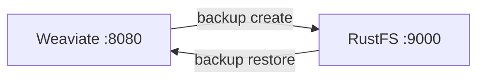
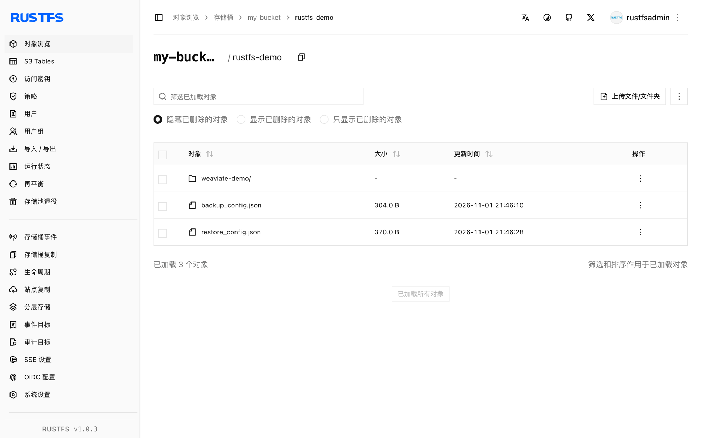

本指南将开源向量数据库 [Weaviate](https://github.com/weaviate/weaviate)（面向 AI 搜索与 RAG）通过其 `backup-s3` 模块连接到 **RustFS**。你将启用该模块，创建集合并插入向量，在桶中创建备份，再执行恢复。整个流程使用 `semitechnologies/weaviate:1.31.0` 向 RustFS 桶备份验证通过。

你需要 Docker。本部署用于本地集成测试，不适用于生产环境。

## 架构



备份会把 `backup_config.json`、每个类的 `backup.json` 和数据分块写入桶前缀 `<backup-id>/`，恢复时按原集合名读回。

## 1. 启用 backup-s3 模块

带模块和 S3 设置启动 Weaviate。凭证走标准 AWS 变量——Weaviate 1.31 的模块读取 `AWS_ACCESS_KEY_ID` 和 `AWS_SECRET_ACCESS_KEY`，不读 `BACKUP_S3_ACCESS_KEY_ID`：

```bash
docker run -d --name weaviate -p 8080:8080 \
  -e QUERY_DEFAULTS_LIMIT=20 \
  -e AUTHENTICATION_ANONYMOUS_ACCESS_ENABLED=true \
  -e PERSISTENCE_DATA_PATH=/var/lib/weaviate \
  -e ENABLE_MODULES=backup-s3 \
  -e BACKUP_S3_BUCKET=my-bucket \
  -e AWS_REGION=us-east-1 \
  -e AWS_ACCESS_KEY_ID=<your-access-key> \
  -e AWS_SECRET_ACCESS_KEY=<your-secret-key> \
  -e BACKUP_S3_ENDPOINT=<your-rustfs-endpoint>:9000 \
  -e BACKUP_S3_USE_SSL=false \
  -e CLUSTER_HOSTNAME=weaviate-demo \
  semitechnologies/weaviate:1.31.0
```

:::note[端点格式与凭证]

`BACKUP_S3_ENDPOINT` 只接受不带协议的 `host:port`——模块背后的 AWS SDK Go v1 对 `http://...` 形式会报 `Endpoint url cannot have fully qualified paths`。TLS 由 `BACKUP_S3_USE_SSL=false` 控制，请求为路径样式。误传 `BACKUP_S3_ACCESS_KEY_ID` 而不是 `AWS_ACCESS_KEY_ID` 时客户端是匿名的，每次备份都会报 `Access Denied`。

:::

确认模块已加载：

```bash
curl -s http://localhost:8080/v1/meta | grep -o "backup-s3"
```

## 2. 创建集合并备份

Weaviate 1.31 用 `POST /v1/schema` 建集合。插入两个对象后发起备份：

```bash
curl -s -X POST http://localhost:8080/v1/schema \
  -H "Content-Type: application/json" \
  -d '{"class":"Doc","vectorizer":"none","properties":[{"name":"title","dataType":["text"]}]}'

curl -s -X POST http://localhost:8080/v1/objects -H "Content-Type: application/json" \
  -d '{"class":"Doc","properties":{"title":"RustFS vector backup"},"vector":[0.11,0.22,0.33,0.44]}'

curl -s -X POST http://localhost:8080/v1/backups/s3 -H "Content-Type: application/json" \
  -d '{"id":"rustfs-demo"}'
```

```json
{"backend":"s3","classes":["Doc"],"id":"rustfs-demo","path":"s3://my-bucket/rustfs-demo","status":"STARTED"}
```

等状态到 `SUCCESS`，确认对象已在 RustFS，替换全部连接占位符：

```bash
curl -s http://localhost:8080/v1/backups/s3/rustfs-demo
aws s3 ls s3://my-bucket/rustfs-demo/ --recursive \
  --endpoint-url http://<your-rustfs-endpoint>:9000
```

```text
2026-11-01 13:46:10        304 rustfs-demo/backup_config.json
2026-11-01 13:46:08       1406 rustfs-demo/weaviate-demo/Doc/chunk-1
2026-11-01 13:46:08      27666 rustfs-demo/weaviate-demo/backup.json
```



## 3. 恢复

把备份恢复进 Weaviate（干净恢复先删掉在线集合）：

```bash
curl -s -X POST http://localhost:8080/v1/backups/s3/rustfs-demo/restore \
  -H "Content-Type: application/json" -d '{}'
```

查询恢复后的数据：

```bash
curl -s -X POST http://localhost:8080/v1/graphql -H "Content-Type: application/json" \
  -d '{"query":"{Get{Doc(limit:2){title}}}"}'
```

```json
{"data":{"Get":{"Doc":[{"title":"RustFS vector backup"},{"title":"Weaviate on object storage"}]}}}
```

## 4. 停止或重置

保留桶内对象并拆除演示环境：

```bash
docker rm -f weaviate
```

删除已存储的备份：

```bash
aws s3 rm s3://my-bucket/rustfs-demo --recursive \
  --endpoint-url http://<your-rustfs-endpoint>:9000
```

## 故障排查

### 启动报 `Endpoint url cannot have fully qualified paths`

`BACKUP_S3_ENDPOINT` 带了协议。改用纯 `host:port` 并设置 `BACKUP_S3_USE_SSL=false`。

### 创建备份时报 `Access Denied`

模块没拿到凭证。Weaviate 1.31 的 S3 客户端读环境变量 `AWS_ACCESS_KEY_ID` 和 `AWS_SECRET_ACCESS_KEY`（或 `AWS_ACCESS_KEY`/`AWS_SECRET_KEY`）——只设 `BACKUP_S3_ACCESS_KEY_ID` 不够。

### 错误里出现 `s3://my-bucket/s3Path/...`

该版本里 `BACKUP_S3_PATH` 是桶内子前缀，不是路径样式开关——不要设成 `s3Path`。Weaviate 的 S3 客户端对自定义端点自动使用路径样式。

### `check if backup ... exists` 报意外错误

容器到 RustFS 不通。确认端点主机可解析且桶存在。

## 下一步

- 在自动化备份计划前，先阅读 [S3 兼容性说明](/administration/protocols/s3)。
- 使用[访问密钥管理](/security-compliance/iam/access-token)创建专用的生产凭证。
- 按照 [Weaviate 备份文档](https://docs.weaviate.io/deploy/configuration/backups)在同一个桶上使用恢复过滤、基于角色的备份与文件系统备选方案。
